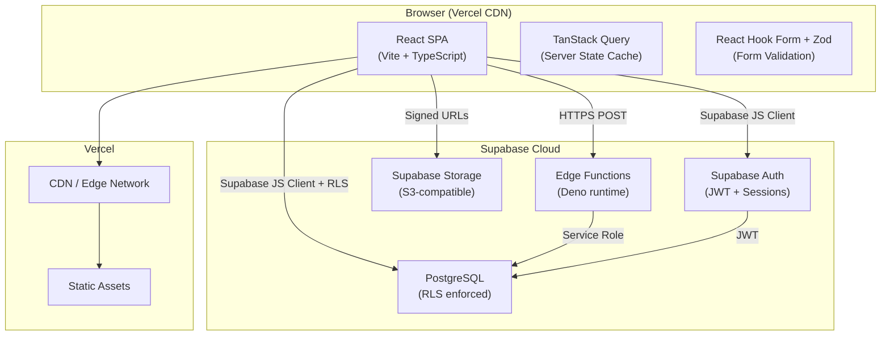
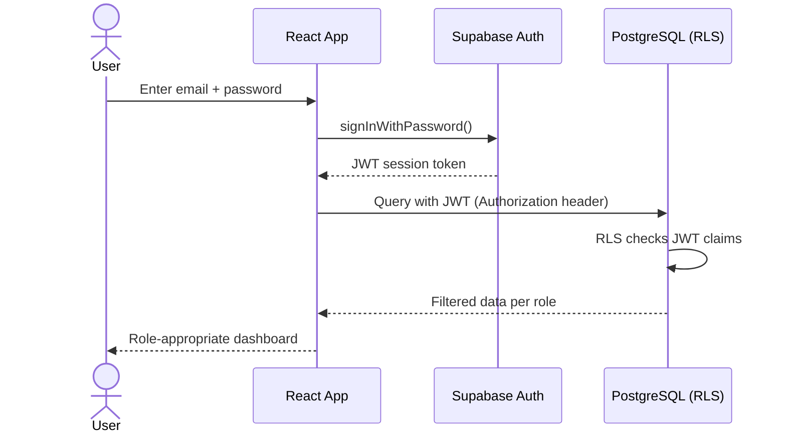
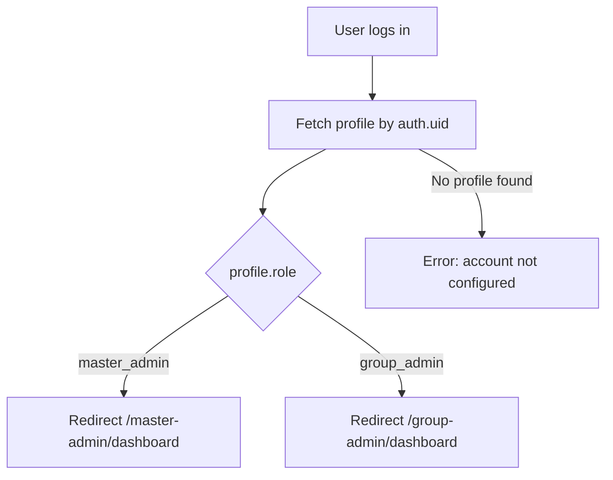
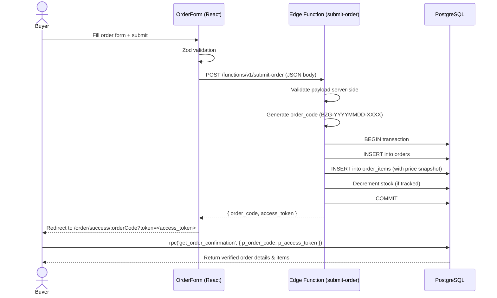
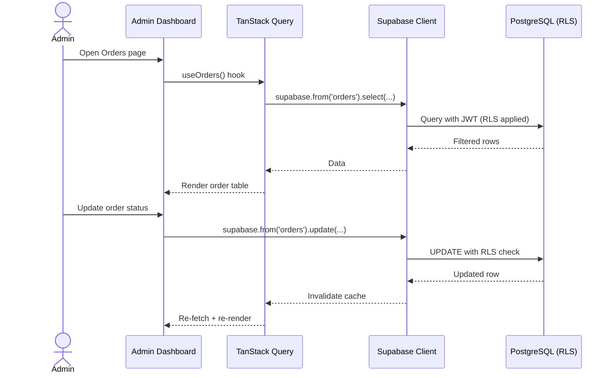

# B-Zooginer — Architecture

This document describes the full technical architecture of the B-Zooginer platform: system components, data flow, frontend structure, backend design, and cross-cutting concerns.

---

## Table of Contents

1. [System Overview](#1-system-overview)
2. [Architecture Diagram](#2-architecture-diagram)
3. [Frontend Architecture](#3-frontend-architecture)
4. [Backend Architecture](#4-backend-architecture)
5. [Authentication & Authorization](#5-authentication--authorization)
6. [Data Flow](#6-data-flow)
7. [State Management](#7-state-management)
8. [Routing Structure](#8-routing-structure)
9. [API Layer](#9-api-layer)
10. [File Storage](#10-file-storage)
11. [Edge Functions](#11-edge-functions)
12. [Performance Considerations](#12-performance-considerations)

---

## 1. System Overview

B-Zooginer is a **single-page application (SPA)** built with React + TypeScript, deployed on **Vercel**, with **Supabase** serving as the complete backend: database (PostgreSQL), authentication, file storage, and serverless functions.

There is no custom REST/GraphQL API server. All data access is through:
- **Supabase JS Client** (`@supabase/supabase-js`) with RLS-enforced queries
- **Supabase Edge Functions** (Deno) for sensitive operations (e.g., public order submission)

---

## 2. Architecture Diagram



---

## 3. Frontend Architecture

### 3.1 Folder Structure

```
c:\laragon\www\B-Zooginer\
├── public/                    # Static assets (favicon, og-image)
├── src/
│   ├── components/
│   │   ├── ui/                # shadcn/ui primitives (Button, Input, Dialog, etc.)
│   │   ├── shared/            # Reusable cross-feature components
│   │   │   ├── OrderStatusBadge.tsx
│   │   │   ├── PaymentStatusBadge.tsx
│   │   │   ├── DataTable.tsx
│   │   │   ├── ConfirmDialog.tsx
│   │   │   ├── ImageUploader.tsx
│   │   │   └── EmptyState.tsx
│   │   ├── public/            # Public storefront components
│   │   │   ├── Navbar.tsx
│   │   │   ├── Footer.tsx
│   │   │   ├── GroupCard.tsx
│   │   │   ├── ProductCard.tsx
│   │   │   ├── OrderForm.tsx
│   │   │   └── HeroBanner.tsx
│   │   └── admin/             # Admin dashboard components
│   │       ├── Sidebar.tsx
│   │       ├── TopBar.tsx
│   │       ├── StatCard.tsx
│   │       ├── OrderTable.tsx
│   │       ├── ProductForm.tsx
│   │       └── RevenueChart.tsx
│   ├── pages/
│   │   ├── public/
│   │   │   ├── HomePage.tsx
│   │   │   ├── GroupStorePage.tsx
│   │   │   ├── ProductDetailPage.tsx
│   │   │   ├── OrderFormPage.tsx
│   │   │   └── OrderLookupPage.tsx
│   │   ├── master-admin/
│   │   │   ├── DashboardPage.tsx
│   │   │   ├── GroupsPage.tsx
│   │   │   ├── GroupDetailPage.tsx
│   │   │   ├── OrdersPage.tsx
│   │   │   ├── OrderDetailPage.tsx
│   │   │   ├── UsersPage.tsx
│   │   │   ├── ReportsPage.tsx
│   │   │   └── SettingsPage.tsx
│   │   └── group-admin/
│   │       ├── DashboardPage.tsx
│   │       ├── ProductsPage.tsx
│   │       ├── ProductFormPage.tsx
│   │       ├── OrdersPage.tsx
│   │       ├── OrderDetailPage.tsx
│   │       ├── PaymentsPage.tsx
│   │       └── ReportsPage.tsx
│   ├── hooks/
│   │   ├── useAuth.ts         # Auth state + role resolution
│   │   ├── useOrders.ts       # TanStack Query hooks for orders
│   │   ├── useProducts.ts
│   │   ├── useGroups.ts
│   │   └── useProfile.ts
│   ├── services/              # Supabase query functions (pure async)
│   │   ├── orders.service.ts
│   │   ├── products.service.ts
│   │   ├── groups.service.ts
│   │   ├── profiles.service.ts
│   │   └── reports.service.ts
│   ├── types/
│   │   ├── database.types.ts  # Auto-generated from Supabase CLI
│   │   ├── order.types.ts
│   │   ├── product.types.ts
│   │   └── group.types.ts
│   ├── lib/
│   │   ├── supabase.ts        # Supabase client singleton
│   │   ├── utils.ts           # cn(), formatCurrency(), formatDate()
│   │   └── constants.ts       # Enums, config values
│   └── store/
│       └── authStore.ts       # Zustand store for auth session (optional)
├── supabase/
│   ├── migrations/            # SQL migration files
│   ├── functions/             # Edge Functions (Deno)
│   │   └── submit-order/
│   │       └── index.ts
│   └── seed.sql               # Development seed data
├── .env.local                 # Local env vars (never committed)
├── .env.example               # Env template (committed)
├── vite.config.ts
├── tailwind.config.ts
├── tsconfig.json
└── package.json
```

### 3.2 Component Design Principles

- **shadcn/ui** components live in `src/components/ui/` — never modified directly; customized via Tailwind variants
- **Shared components** are role-agnostic and accept typed props with no Supabase calls inside
- **Page components** own data fetching via TanStack Query hooks; they pass data down to components
- **No prop-drilling beyond 2 levels** — use context or query hooks for deeply shared state

---

## 4. Backend Architecture

### 4.1 Supabase Services Used

| Service | Usage |
|---------|-------|
| **PostgreSQL** | All application data: groups, products, orders, profiles |
| **Auth** | JWT-based session management; email+password for MASTER_ADMIN and GROUP_ADMIN |
| **Row-Level Security** | Per-table access rules enforced at the database level |
| **Storage** | Group posters, product images, site assets |
| **Edge Functions** | Public order submission, order code generation |
| **Realtime** | Optional: future live order notifications for admins |

### 4.2 Database Tables (Summary)

| Table | Purpose |
|-------|---------|
| `profiles` | Extends `auth.users`; stores role and group_id |
| `groups` | Student entrepreneurship groups |
| `products` | Products per group |
| `product_variants` | Variants (size, flavor, etc.) per product |
| `orders` | Pre-orders from all sources |
| `order_items` | Line items per order (links to product_variants) |
| `activity_logs` | Audit trail for admin actions |
| `site_settings` | Key-value store for platform configuration |

> [!NOTE]
> Full schema with column definitions, indexes, and RLS policies is in [`DATABASE_SCHEMA.md`](./DATABASE_SCHEMA.md).

---

## 5. Authentication & Authorization

### 5.1 Auth Flow



### 5.2 Role Determination

Roles are stored in the `profiles` table (not in JWT claims by default). After login:

1. App fetches `profiles` row for `auth.uid()`
2. `role` field (`master_admin` | `group_admin`) determines which dashboard to render
3. `group_id` field on `profiles` gates Group Admin data access



### 5.3 Public (Unauthenticated) Access

- Public users access the storefront without any auth
- Supabase `anon` key is used for storefront queries (read-only, published data only)
- Order submission is routed through an **Edge Function** that uses the **service role key** server-side — never exposed to the browser

---

## 6. Data Flow

### 6.1 Public Order Submission



### 6.2 Admin Order Management



---

## 7. State Management

| State Type | Tool | Location |
|-----------|------|----------|
| Server state (remote data) | TanStack Query | `src/hooks/` |
| Auth session | Supabase Auth listener + optional Zustand | `src/store/authStore.ts` |
| Form state | React Hook Form | Inside page/form components |
| UI state (modals, tabs) | `useState` / `useReducer` | Local to components |
| Global UI state | React Context (if needed) | `src/lib/context/` |

> [!TIP]
> Avoid Zustand or global state for server data. TanStack Query handles caching, deduplication, refetching, and stale management. Only use global stores for truly client-only state (e.g., auth profile, sidebar open/closed).

---

## 8. Routing Structure

React Router v6 with nested layouts:

```
/                               → Public layout (Bahasa Indonesia UI)
  /                             → HomePage (Beranda)
  /groups                       → GroupsPage (Daftar Stan)
  /groups/:slug                 → GroupStorePage (Katalog Stan)
  /groups/:slug/products/:id    → ProductDetailPage (Detail Produk & Selektor Varian)
  /order                        → OrderFormPage (Formulir PO Publik)
  /order/success/:orderCode     → OrderConfirmationPage (Verifikasi token ?token=...)
  /track                        → OrderLookupPage (Lacak Pesanan via Kode + Token)

/login                          → LoginPage (Masuk Akun Admin)

/master-admin/                  → MasterAdmin layout (role: master_admin)
  dashboard                     → OverviewPage (Ringkasan Metrik)
  groups                        → GroupsPage (Kelola Stan)
  groups/new                    → CreateGroupPage
  groups/:id                    → GroupDetailPage
  admins                        → AdminAccountsPage (Kelola Akun Admin Stan)
  products                      → ProductsPage (Semua Produk)
  orders                        → OrdersPage (Semua Pesanan)
  orders/new                    → ManualOrderPage (Input Cepat Roadshow Kelas)
  orders/:id                    → OrderDetailPage
  payments                      → PaymentsPage (Kelola Pembayaran)
  reports                       → ReportsPage (Laporan Global & Analitik)
  export                        → ExportPage (Ekspor Excel)
  settings                      → SettingsPage (Pengaturan Web)
  logs                          → ActivityLogsPage (Log Audit)
  account                       → AccountSettingsPage

/group-admin/                   → GroupAdmin layout (role: group_admin, scoped to group_id)
  dashboard                     → OverviewPage (Ringkasan Kelompok)
  products                      → ProductsPage (Kelola Produk)
  products/new                  → ProductFormPage (Tambah Produk & Matriks Varian)
  products/:id/edit             → ProductFormPage
  orders                        → OrdersPage (Pesanan Masuk)
  orders/new                    → ManualOrderPage (Input Pesanan Stan)
  orders/:id                    → OrderDetailPage
  payments                      → PaymentsPage (Konfirmasi Pembayaran Lunas)
  reports                       → ReportsPage (Laporan Penjualan)
  export                        → ExportPage (Ekspor Excel Kelompok)
  settings                      → GroupSettingsPage (Pengaturan Stan)
  account                       → AccountSettingsPage
```

### Route Guards

- `<RequireAuth role="master_admin">` — redirects to `/login` if not authenticated or wrong role
- `<RequireAuth role="group_admin">` — same, with group_id check
- Public routes have no guard; they query only published data

---

## 9. API Layer

All Supabase interactions are wrapped in **service functions** in `src/services/`. These are plain async functions that accept typed parameters and return typed results. TanStack Query hooks in `src/hooks/` call these functions.

**Pattern:**

```typescript
// src/services/orders.service.ts
export async function getOrdersByGroup(groupId: string): Promise<Order[]> {
  const { data, error } = await supabase
    .from('orders')
    .select(`
      *,
      order_items (
        *,
        product_variants ( label, value, price_adjustment )
      )
    `)
    .eq('group_id', groupId)
    .order('created_at', { ascending: false });

  if (error) throw error;
  return data;
}
```

```typescript
// src/hooks/useOrders.ts
export function useGroupOrders(groupId: string) {
  return useQuery({
    queryKey: ['orders', 'group', groupId],
    queryFn: () => getOrdersByGroup(groupId),
    enabled: !!groupId,
  });
}
```

---

## 10. File Storage

Supabase Storage buckets:

| Bucket | Contents | Access |
|--------|---------|--------|
| `groups-media` | Group posters and logos | Public read; authenticated write (master_admin) |
| `products-media` | Product images | Public read; authenticated write (group_admin, master_admin) |
| `site-assets` | Platform logos, hero banners | Public read; authenticated write (master_admin only) |

**Upload flow:**
1. Admin selects file in `ImageUploader` component
2. Client validates: type (image/jpeg, image/png, image/webp), size (< 2 MB)
3. `supabase.storage.from(bucket).upload(path, file)` with upsert
4. Returns public URL stored in the DB record

---

## 11. Edge Functions

Located at `supabase/functions/`. Deployed via Supabase CLI.

| Function | Trigger | Purpose |
|----------|---------|---------|
| `submit-order` | HTTP POST (public) | Validates payload, generates order_code, inserts order + items atomically, decrements stock |

> [!CAUTION]
> Edge Functions are the **only** place the `SUPABASE_SERVICE_ROLE_KEY` is used. It must never be included in frontend environment variables or committed to Git.

---

## 12. Performance Considerations

| Concern | Strategy |
|---------|---------|
| Initial load time | Vite code splitting; lazy-load admin routes |
| Public storefront LCP | Hero image preloaded; Vercel CDN static delivery |
| DB query speed | Indexes on `group_id`, `order_status`, `payment_status`, `created_at` |
| Image optimization | WebP format; aspect-ratio-enforced containers prevent layout shift |
| TanStack Query caching | `staleTime` tuned per query (e.g., 60s for product lists, 10s for orders) |
| Excel export | ExcelJS runs client-side; large exports paginated server-side |
| Supabase cold start | Edge Functions stay warm with low-latency Supabase infra |
