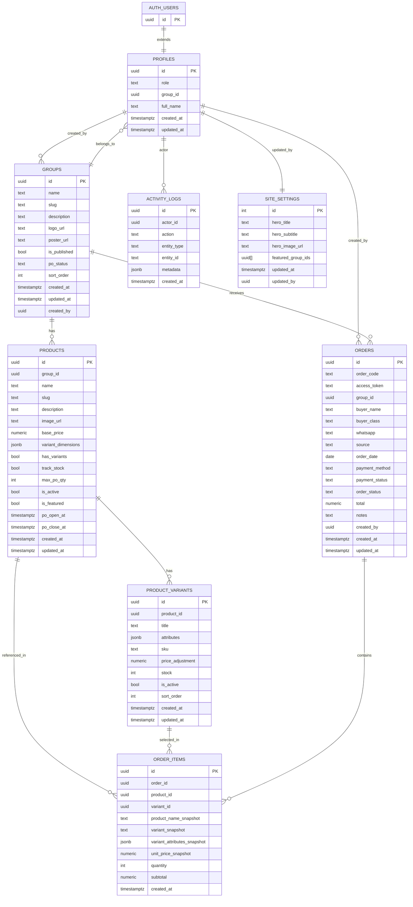

# DATABASE_SCHEMA.md — B-Zooginer

> [!NOTE]
> This document is the canonical reference for the B-Zooginer PostgreSQL schema hosted on Supabase. It covers table definitions, relationships, constraints, indexes, generated values, and design rationale.

---

## Table of Contents

1. [Entity-Relationship Diagram](#entity-relationship-diagram)
2. [Schema Overview](#schema-overview)
3. [Table Definitions](#table-definitions)
   - [profiles](#profiles)
   - [groups](#groups)
   - [products](#products)
   - [product_variants](#product_variants)
   - [orders](#orders)
   - [order_items](#order_items)
   - [activity_logs](#activity_logs)
   - [site_settings](#site_settings)
4. [Enumerations](#enumerations)
5. [Indexes](#indexes)
6. [Order Code Generation](#order-code-generation)
7. [Stock Deduction Strategy](#stock-deduction-strategy)
8. [Price Snapshot Rationale](#price-snapshot-rationale)
9. [Full Migration SQL](#full-migration-sql)

---

## Entity-Relationship Diagram



---

## Schema Overview

| Table | Purpose | Row Count Estimate |
|---|---|---|
| `profiles` | Extends `auth.users`; stores role and group assignment | Low (< 20 rows) |
| `groups` | Student group/booth entities | Low (5–10 rows) |
| `products` | Products offered by each group | Medium (10–100 rows) |
| `product_variants` | Size/flavor/etc. variants per product | Medium (20–300 rows) |
| `orders` | Customer pre-orders (all sources) | High (thousands) |
| `order_items` | Line items per order | High (thousands) |
| `activity_logs` | Audit trail for admin actions | Very High (append-only) |
| `site_settings` | Singleton global settings row | 1 row |

All tables live in the **public** schema. Supabase Auth tables live in the **auth** schema (managed by Supabase).

---

## Table Definitions

### profiles

Extension of `auth.users`. Created automatically via trigger on new auth user sign-up.

```sql
CREATE TABLE public.profiles (
  id          uuid PRIMARY KEY REFERENCES auth.users(id) ON DELETE CASCADE,
  role        public.user_role NOT NULL DEFAULT 'group_admin',
  group_id    uuid REFERENCES public.groups(id) ON DELETE SET NULL,
  full_name   text NOT NULL DEFAULT '',
  created_at  timestamptz NOT NULL DEFAULT now(),
  updated_at  timestamptz NOT NULL DEFAULT now()
);
```

| Column | Type | Nullable | Default | Notes |
|---|---|---|---|---|
| `id` | uuid | NO | — | FK → `auth.users(id)`, CASCADE delete |
| `role` | `user_role` enum | NO | `group_admin` | `master_admin` or `group_admin` |
| `group_id` | uuid | YES | NULL | FK → `groups(id)`; NULL for master_admin |
| `full_name` | text | NO | `''` | Display name |
| `created_at` | timestamptz | NO | `now()` | Auto-set on insert |
| `updated_at` | timestamptz | NO | `now()` | Updated via trigger |

**Trigger — auto-create profile on sign-up:**

```sql
CREATE OR REPLACE FUNCTION public.handle_new_user()
RETURNS TRIGGER LANGUAGE plpgsql SECURITY DEFINER SET search_path = public AS $$
BEGIN
  INSERT INTO public.profiles (id, full_name)
  VALUES (NEW.id, COALESCE(NEW.raw_user_meta_data->>'full_name', ''));
  RETURN NEW;
END;
$$;

CREATE TRIGGER on_auth_user_created
  AFTER INSERT ON auth.users
  FOR EACH ROW EXECUTE FUNCTION public.handle_new_user();
```

**Trigger — auto-update `updated_at`:**

```sql
CREATE OR REPLACE FUNCTION public.set_updated_at()
RETURNS TRIGGER LANGUAGE plpgsql AS $$
BEGIN
  NEW.updated_at = now();
  RETURN NEW;
END;
$$;

CREATE TRIGGER profiles_set_updated_at
  BEFORE UPDATE ON public.profiles
  FOR EACH ROW EXECUTE FUNCTION public.set_updated_at();
```

> [!IMPORTANT]
> `profiles.role` must be set by MASTER_ADMIN only after account creation. The default is `group_admin` to prevent accidental privilege escalation.

---

### groups

Represents each student group/entrepreneurship booth.

```sql
CREATE TABLE public.groups (
  id           uuid PRIMARY KEY DEFAULT gen_random_uuid(),
  name         text NOT NULL,
  slug         text NOT NULL UNIQUE,
  description  text,
  logo_url     text,
  poster_url   text,
  is_published boolean NOT NULL DEFAULT false,
  po_status    public.po_status NOT NULL DEFAULT 'coming_soon',
  sort_order   integer NOT NULL DEFAULT 0,
  created_at   timestamptz NOT NULL DEFAULT now(),
  updated_at   timestamptz NOT NULL DEFAULT now(),
  created_by   uuid REFERENCES public.profiles(id) ON DELETE SET NULL
);
```

| Column | Type | Nullable | Default | Notes |
|---|---|---|---|---|
| `id` | uuid | NO | `gen_random_uuid()` | PK |
| `name` | text | NO | — | Display name, e.g. "Kelompok Maju" |
| `slug` | text | NO | — | URL-safe identifier, UNIQUE |
| `description` | text | YES | NULL | Rich description |
| `logo_url` | text | YES | NULL | Supabase Storage path |
| `poster_url` | text | YES | NULL | Supabase Storage path (4:5 ratio) |
| `is_published` | boolean | NO | `false` | Controls public visibility |
| `po_status` | `po_status` enum | NO | `coming_soon` | `open` / `coming_soon` / `closed` |
| `sort_order` | integer | NO | `0` | Display ordering on storefront |
| `created_at` | timestamptz | NO | `now()` | — |
| `updated_at` | timestamptz | NO | `now()` | Via trigger |
| `created_by` | uuid | YES | NULL | FK → `profiles(id)` |

**Constraint — slug format:**
```sql
ALTER TABLE public.groups
  ADD CONSTRAINT groups_slug_format CHECK (slug ~ '^[a-z0-9\-]+$');
```

---

### products

Products offered for pre-order by a group.

```sql
CREATE TABLE public.products (
  id           uuid PRIMARY KEY DEFAULT gen_random_uuid(),
  group_id     uuid NOT NULL REFERENCES public.groups(id) ON DELETE CASCADE,
  name         text NOT NULL,
  slug         text NOT NULL,
  description  text,
  image_url    text,
  base_price   numeric(12,2) NOT NULL CHECK (base_price >= 0),
  has_variants boolean NOT NULL DEFAULT false,
  track_stock  boolean NOT NULL DEFAULT false,
  max_po_qty   integer CHECK (max_po_qty > 0),
  is_active    boolean NOT NULL DEFAULT true,
  is_featured  boolean NOT NULL DEFAULT false,
  po_open_at   timestamptz,
  po_close_at  timestamptz,
  created_at   timestamptz NOT NULL DEFAULT now(),
  updated_at   timestamptz NOT NULL DEFAULT now(),
  UNIQUE (group_id, slug)
);
```

| Column | Type | Nullable | Default | Notes |
|---|---|---|---|---|
| `id` | uuid | NO | `gen_random_uuid()` | PK |
| `group_id` | uuid | NO | — | FK → `groups(id)`, CASCADE delete |
| `name` | text | NO | — | Product name |
| `slug` | text | NO | — | UNIQUE per group |
| `description` | text | YES | NULL | Full description |
| `image_url` | text | YES | NULL | Supabase Storage path |
| `base_price` | numeric(12,2) | NO | — | Price without variant adjustment |
| `variant_dimensions` | jsonb | NO | `'[]'::jsonb` | Multi-dimension schema, e.g. `[{"name": "Ukuran", "options": ["S", "M", "L"]}, {"name": "Rasa", "options": ["Cokelat", "Keju"]}]` |
| `has_variants` | boolean | NO | `false` | If true, check `product_variants` |
| `track_stock` | boolean | NO | `false` | Whether stock is enforced |
| `max_po_qty` | integer | YES | NULL | Per-order quantity limit |
| `is_active` | boolean | NO | `true` | Public visibility |
| `is_featured` | boolean | NO | `false` | Homepage featured flag |
| `po_open_at` | timestamptz | YES | NULL | Pre-order window open |
| `po_close_at` | timestamptz | YES | NULL | Pre-order window close |
| `created_at` | timestamptz | NO | `now()` | — |
| `updated_at` | timestamptz | NO | `now()` | Via trigger |

**Constraint — PO window:**
```sql
ALTER TABLE public.products
  ADD CONSTRAINT products_po_window CHECK (po_close_at IS NULL OR po_open_at IS NULL OR po_close_at > po_open_at);
```

> [!TIP]
> When `has_variants = true`, the product supports multi-dimensional options (e.g. Ukuran & Rasa). The purchasable combinations live in `product_variants`. Effective price is `base_price + variant.price_adjustment`. When `has_variants = false`, `base_price` is the final unit price.

---

### product_variants

Each variant represents a concrete purchasable combination of options across one or more dimensions (e.g. Ukuran: L, Rasa: Cokelat).

```sql
CREATE TABLE public.product_variants (
  id               uuid PRIMARY KEY DEFAULT gen_random_uuid(),
  product_id       uuid NOT NULL REFERENCES public.products(id) ON DELETE CASCADE,
  title            text NOT NULL,
  attributes       jsonb NOT NULL DEFAULT '{}'::jsonb,
  sku              text,
  price_adjustment numeric(12,2) NOT NULL DEFAULT 0,
  stock            integer CHECK (stock >= 0),
  is_active        boolean NOT NULL DEFAULT true,
  sort_order       integer NOT NULL DEFAULT 0,
  created_at       timestamptz NOT NULL DEFAULT now(),
  updated_at       timestamptz NOT NULL DEFAULT now()
);
```

| Column | Type | Nullable | Default | Notes |
|---|---|---|---|---|
| `id` | uuid | NO | `gen_random_uuid()` | PK |
| `product_id` | uuid | NO | — | FK → `products(id)`, CASCADE |
| `title` | text | NO | — | Display label, e.g. "Ukuran: L, Rasa: Cokelat" |
| `attributes` | jsonb | NO | `'{}'::jsonb` | Multi-dimension key-value pairs, e.g. `{"ukuran": "L", "rasa": "Cokelat"}` |
| `sku` | text | YES | NULL | Optional SKU identifier |
| `price_adjustment` | numeric(12,2) | NO | `0` | Added to `base_price`; can be negative or positive |
| `stock` | integer | YES | NULL | NULL = unlimited; enforced when `track_stock = true` |
| `is_active` | boolean | NO | `true` | Whether this variant combination is orderable |
| `sort_order` | integer | NO | `0` | Display order |
| `created_at` | timestamptz | NO | `now()` | — |
| `updated_at` | timestamptz | NO | `now()` | Via trigger |

---

### orders

All pre-orders from all sources (public, group_admin, master_admin) stored in one table.

```sql
CREATE TABLE public.orders (
  id              uuid PRIMARY KEY DEFAULT gen_random_uuid(),
  order_code      text NOT NULL UNIQUE,
  access_token    text NOT NULL DEFAULT encode(gen_random_bytes(32), 'hex'),
  group_id        uuid NOT NULL REFERENCES public.groups(id),
  buyer_name      text NOT NULL,
  buyer_class     text NOT NULL,
  whatsapp        text,
  source          public.order_source NOT NULL DEFAULT 'public',
  order_date      date NOT NULL DEFAULT CURRENT_DATE,
  payment_method  public.payment_method NOT NULL,
  payment_status  public.payment_status NOT NULL DEFAULT 'unpaid',
  order_status    public.order_status NOT NULL DEFAULT 'new',
  total           numeric(12,2) NOT NULL CHECK (total >= 0),
  notes           text,
  created_by      uuid REFERENCES public.profiles(id) ON DELETE SET NULL,
  created_at      timestamptz NOT NULL DEFAULT now(),
  updated_at      timestamptz NOT NULL DEFAULT now()
);
CREATE UNIQUE INDEX idx_orders_access_token ON public.orders (access_token);
```

| Column | Type | Nullable | Default | Notes |
|---|---|---|---|---|
| `id` | uuid | NO | `gen_random_uuid()` | PK |
| `order_code` | text | NO | — | Generated; UNIQUE; e.g. `BZG-20261121-XXXX` |
| `access_token` | text | NO | `encode(gen_random_bytes(32), 'hex')` | Secure 256-bit high-entropy token for public order confirmation access |
| `group_id` | uuid | NO | — | FK → `groups(id)` |
| `buyer_name` | text | NO | — | Customer display name |
| `buyer_class` | text | NO | — | Class/grade of buyer (e.g. "XII IPA 1") |
| `whatsapp` | text | YES | NULL | Phone number for follow-up |
| `source` | `order_source` enum | NO | `'public'` | Who placed the order |
| `order_date` | date | NO | `CURRENT_DATE` | Calendar date of order |
| `payment_method` | `payment_method` enum | NO | — | `cash` or `transfer` |
| `payment_status` | `payment_status` enum | NO | `'unpaid'` | `unpaid` or `paid` |
| `order_status` | `order_status` enum | NO | `'new'` | Lifecycle status |
| `total` | numeric(12,2) | NO | — | Sum of all `order_items.subtotal` |
| `notes` | text | YES | NULL | Buyer notes |
| `created_by` | uuid | YES | NULL | FK → `profiles(id)`; NULL for public orders |
| `created_at` | timestamptz | NO | `now()` | — |
| `updated_at` | timestamptz | NO | `now()` | Via trigger |

> [!IMPORTANT]
> `payment_status` can only be changed by `master_admin` or `group_admin` (for their own group's orders) via authenticated RPC/API — never by the public buyer. This is enforced by RLS (see SECURITY.md).
> `access_token` ensures anonymous buyers can view their confirmation screen securely without allowing any third party to scrape or enumerate student orders.

---

### order_items

Line items for each order. Snapshots protect against retroactive price changes.

```sql
CREATE TABLE public.order_items (
  id                          uuid PRIMARY KEY DEFAULT gen_random_uuid(),
  order_id                    uuid NOT NULL REFERENCES public.orders(id) ON DELETE CASCADE,
  product_id                  uuid NOT NULL REFERENCES public.products(id),
  variant_id                  uuid REFERENCES public.product_variants(id) ON DELETE SET NULL,
  product_name_snapshot       text NOT NULL,
  variant_snapshot            text,
  variant_attributes_snapshot jsonb NOT NULL DEFAULT '{}'::jsonb,
  unit_price_snapshot         numeric(12,2) NOT NULL CHECK (unit_price_snapshot >= 0),
  quantity                    integer NOT NULL CHECK (quantity > 0),
  subtotal                    numeric(12,2) NOT NULL CHECK (subtotal >= 0),
  created_at                  timestamptz NOT NULL DEFAULT now(),
  CONSTRAINT order_items_subtotal_check CHECK (subtotal = unit_price_snapshot * quantity)
);
```

| Column | Type | Nullable | Default | Notes |
|---|---|---|---|---|
| `id` | uuid | NO | `gen_random_uuid()` | PK |
| `order_id` | uuid | NO | — | FK → `orders(id)`, CASCADE delete |
| `product_id` | uuid | NO | — | FK → `products(id)` (no cascade; product is kept) |
| `variant_id` | uuid | YES | NULL | FK → `product_variants(id)`, SET NULL on delete |
| `product_name_snapshot` | text | NO | — | Name at time of order |
| `variant_snapshot` | text | YES | NULL | Description snapshot, e.g. "Ukuran: L, Rasa: Cokelat" |
| `variant_attributes_snapshot` | jsonb | NO | `'{}'::jsonb` | Structured attributes snapshot, e.g. `{"ukuran": "L", "rasa": "Cokelat"}` |
| `unit_price_snapshot` | numeric(12,2) | NO | — | Effective unit price at time of order |
| `quantity` | integer | NO | — | Positive integer |
| `subtotal` | numeric(12,2) | NO | — | `unit_price_snapshot × quantity` |
| `created_at` | timestamptz | NO | `now()` | — |

**Computed subtotal constraint:**
```sql
ALTER TABLE public.order_items
  ADD CONSTRAINT order_items_subtotal_check
  CHECK (subtotal = unit_price_snapshot * quantity);
```

---

### activity_logs

Append-only audit log. No UPDATE or DELETE permitted (enforced by RLS).

```sql
CREATE TABLE public.activity_logs (
  id           uuid PRIMARY KEY DEFAULT gen_random_uuid(),
  actor_id     uuid REFERENCES public.profiles(id) ON DELETE SET NULL,
  action       text NOT NULL,
  entity_type  text NOT NULL,
  entity_id    text NOT NULL,
  metadata     jsonb NOT NULL DEFAULT '{}',
  created_at   timestamptz NOT NULL DEFAULT now()
);
```

| Column | Type | Nullable | Default | Notes |
|---|---|---|---|---|
| `id` | uuid | NO | `gen_random_uuid()` | PK |
| `actor_id` | uuid | YES | NULL | FK → `profiles(id)`; SET NULL if user deleted |
| `action` | text | NO | — | e.g. `order.status_changed`, `product.created` |
| `entity_type` | text | NO | — | e.g. `order`, `product`, `group` |
| `entity_id` | text | NO | — | UUID of the affected entity (stored as text for flexibility) |
| `metadata` | jsonb | NO | `{}` | Context: `{from: 'new', to: 'confirmed'}` |
| `created_at` | timestamptz | NO | `now()` | — |

**Recommended action name conventions:**

| Action | Meaning |
|---|---|
| `order.created` | New order placed |
| `order.status_changed` | `order_status` transition |
| `order.payment_marked` | `payment_status` changed |
| `product.created` | Product added |
| `product.updated` | Product fields changed |
| `group.published` | Group set `is_published = true` |
| `profile.role_changed` | Admin changed a user's role |

---

### site_settings

Singleton row (id = 1). Global storefront configuration.

```sql
CREATE TABLE public.site_settings (
  id                  integer PRIMARY KEY DEFAULT 1,
  hero_title          text NOT NULL DEFAULT 'B-Zooginer',
  hero_subtitle       text NOT NULL DEFAULT '',
  hero_image_url      text,
  featured_group_ids  uuid[] NOT NULL DEFAULT '{}',
  updated_at          timestamptz NOT NULL DEFAULT now(),
  updated_by          uuid REFERENCES public.profiles(id) ON DELETE SET NULL,
  CONSTRAINT site_settings_singleton CHECK (id = 1)
);

-- Seed the singleton row
INSERT INTO public.site_settings (id) VALUES (1) ON CONFLICT DO NOTHING;
```

| Column | Type | Nullable | Default | Notes |
|---|---|---|---|---|
| `id` | integer | NO | `1` | Always 1; singleton enforced by CHECK |
| `hero_title` | text | NO | `'B-Zooginer'` | Main homepage heading |
| `hero_subtitle` | text | NO | `''` | Homepage subheading |
| `hero_image_url` | text | YES | NULL | Supabase Storage path |
| `featured_group_ids` | uuid[] | NO | `{}` | Ordered list of featured group UUIDs |
| `updated_at` | timestamptz | NO | `now()` | Via trigger |
| `updated_by` | uuid | YES | NULL | FK → `profiles(id)` |

---

## Enumerations

```sql
-- User role
CREATE TYPE public.user_role AS ENUM ('master_admin', 'group_admin');

-- Group pre-order status
CREATE TYPE public.po_status AS ENUM ('open', 'coming_soon', 'closed');

-- Order source
CREATE TYPE public.order_source AS ENUM ('master_admin', 'group_admin', 'public');

-- Payment method
CREATE TYPE public.payment_method AS ENUM ('cash', 'transfer');

-- Payment lifecycle
CREATE TYPE public.payment_status AS ENUM ('unpaid', 'paid');

-- Order lifecycle
CREATE TYPE public.order_status AS ENUM ('new', 'confirmed', 'cancelled', 'completed');
```

---

## Indexes

```sql
-- profiles
CREATE INDEX idx_profiles_role      ON public.profiles (role);
CREATE INDEX idx_profiles_group_id  ON public.profiles (group_id);

-- groups
CREATE UNIQUE INDEX idx_groups_slug  ON public.groups (slug);
CREATE INDEX idx_groups_published    ON public.groups (is_published, sort_order);

-- products
CREATE INDEX idx_products_group_id  ON public.products (group_id);
CREATE INDEX idx_products_active     ON public.products (group_id, is_active);
CREATE INDEX idx_products_featured   ON public.products (is_featured) WHERE is_featured = true;
CREATE UNIQUE INDEX idx_products_group_slug ON public.products (group_id, slug);

-- product_variants
CREATE INDEX idx_variants_product_id ON public.product_variants (product_id, sort_order);

-- orders
CREATE UNIQUE INDEX idx_orders_code        ON public.orders (order_code);
CREATE INDEX idx_orders_group_id           ON public.orders (group_id);
CREATE INDEX idx_orders_status             ON public.orders (order_status);
CREATE INDEX idx_orders_payment_status     ON public.orders (payment_status);
CREATE INDEX idx_orders_created_at         ON public.orders (created_at DESC);
CREATE INDEX idx_orders_buyer_name         ON public.orders USING gin (to_tsvector('simple', buyer_name));

-- order_items
CREATE INDEX idx_order_items_order_id   ON public.order_items (order_id);
CREATE INDEX idx_order_items_product_id ON public.order_items (product_id);

-- activity_logs
CREATE INDEX idx_activity_logs_actor_id    ON public.activity_logs (actor_id);
CREATE INDEX idx_activity_logs_entity      ON public.activity_logs (entity_type, entity_id);
CREATE INDEX idx_activity_logs_created_at  ON public.activity_logs (created_at DESC);
```

---

## Order Code Generation

Order codes are human-readable, unique identifiers displayed to buyers and admins for reference and lookup.

### Format

```
BZG-YYYYMMDD-XXXX
```

| Segment | Example | Description |
|---|---|---|
| `BZG` | `BZG` | Fixed brand prefix |
| `YYYYMMDD` | `20261121` | UTC date at order creation |
| `XXXX` | `A3X9` | 4-character random alphanumeric (uppercase, excluding O, I, 0, 1 for legibility) |

**Example:** `BZG-20261121-A3X9`

### Generation Function

```sql
CREATE OR REPLACE FUNCTION public.generate_order_code()
RETURNS text LANGUAGE plpgsql AS $$
DECLARE
  date_part  text;
  rand_part  text;
  candidate  text;
  safe_chars text := 'ABCDEFGHJKLMNPQRSTUVWXYZ23456789';  -- no O, I, 0, 1
  attempts   integer := 0;
BEGIN
  date_part := to_char(now() AT TIME ZONE 'UTC', 'YYYYMMDD');

  LOOP
    -- Pick 4 random characters from safe_chars
    rand_part := '';
    FOR i IN 1..4 LOOP
      rand_part := rand_part || substr(safe_chars,
        floor(random() * length(safe_chars) + 1)::integer, 1);
    END LOOP;

    candidate := 'BZG-' || date_part || '-' || rand_part;

    -- Check uniqueness
    IF NOT EXISTS (SELECT 1 FROM public.orders WHERE order_code = candidate) THEN
      RETURN candidate;
    END IF;

    attempts := attempts + 1;
    IF attempts > 10 THEN
      RAISE EXCEPTION 'Could not generate unique order code after 10 attempts';
    END IF;
  END LOOP;
END;
$$;
```

> [!NOTE]
> The 4-char random segment from a 32-character safe alphabet gives 32⁴ = 1,048,576 combinations per day. At realistic order volumes for a school pre-order system (hundreds per day at most), collision probability is negligible. The retry loop guarantees uniqueness without an external sequence.

### Usage in Edge Function

```typescript
// Called inside the submit-order Edge Function
const { data: orderCode } = await supabaseAdmin
  .rpc('generate_order_code');
```

---

## Stock Deduction Strategy

Stock is tracked per `product_variant` (when `products.track_stock = true`). Deduction must be atomic to prevent overselling under concurrent orders.

### Design Principles

1. **Atomic decrement** via a DB function called inside a transaction.
2. **Check before deduct**: never decrement below 0.
3. **Called from Edge Function** only — public clients cannot call directly.
4. **Return remaining stock** so the Edge Function can confirm success.

### Stock Deduction Function

```sql
CREATE OR REPLACE FUNCTION public.deduct_variant_stock(
  p_variant_id uuid,
  p_quantity    integer
)
RETURNS integer   -- returns remaining stock after deduction
LANGUAGE plpgsql AS $$
DECLARE
  v_current_stock integer;
  v_track_stock   boolean;
BEGIN
  -- Verify tracking is enabled for this product
  SELECT p.track_stock INTO v_track_stock
  FROM public.product_variants pv
  JOIN public.products p ON p.id = pv.product_id
  WHERE pv.id = p_variant_id;

  IF NOT FOUND THEN
    RAISE EXCEPTION 'Variant not found: %', p_variant_id;
  END IF;

  -- If stock tracking not enabled, skip deduction
  IF NOT v_track_stock THEN
    RETURN NULL;
  END IF;

  -- Atomic check-and-decrement (FOR UPDATE locks the row)
  UPDATE public.product_variants
  SET stock = stock - p_quantity
  WHERE id = p_variant_id
    AND stock >= p_quantity   -- prevents negative stock
  RETURNING stock INTO v_current_stock;

  IF NOT FOUND THEN
    RAISE EXCEPTION 'Insufficient stock for variant %', p_variant_id;
  END IF;

  RETURN v_current_stock;
END;
$$;
```

### For Products Without Variants (stock on product level)

When `has_variants = false` and `track_stock = true`, stock is tracked via a `stock` column added to `products` or via a virtual stock computed from variant with `label = 'default'`. The same atomic pattern applies:

```sql
UPDATE public.products
SET max_po_qty = max_po_qty - p_quantity  -- or a dedicated stock column
WHERE id = p_product_id
  AND max_po_qty >= p_quantity
RETURNING max_po_qty;
```

> [!CAUTION]
> Never deduct stock from the frontend client using `UPDATE`. All stock deductions must go through the Edge Function calling the DB function. If the order insert fails after deduction, the Edge Function must increment stock back (or wrap the entire operation in a Postgres transaction via `BEGIN`/`COMMIT`).

### Transaction Wrapping in Edge Function

```typescript
// Pseudo-code for the Edge Function transaction flow
const { error } = await supabaseAdmin.rpc('submit_public_order', {
  p_group_id: groupId,
  p_buyer_name: buyerName,
  p_buyer_class: buyerClass,
  p_whatsapp: whatsapp,
  p_payment_method: paymentMethod,
  p_items: items,  // JSON array
  p_notes: notes,
});
// submit_public_order is a SECURITY DEFINER function that wraps:
// 1. generate_order_code()
// 2. INSERT INTO orders
// 3. FOR EACH item: deduct_variant_stock() + INSERT INTO order_items
// All in one transaction — rolls back if any step fails
```

---

## Price Snapshot Rationale

Order items store `unit_price_snapshot` and `product_name_snapshot` (and `variant_snapshot`) at the time of order creation. This is deliberate and critical.

### Why Snapshots Are Necessary

| Problem Without Snapshot | With Snapshot |
|---|---|
| Admin changes `base_price` → old orders show wrong total | Historical total is preserved exactly |
| Product is deleted → `order_items.unit_price` becomes NULL | Snapshot survives product deletion |
| Variant is renamed → line items are confusing | Snapshot preserves the original label/value |
| Reporting is inconsistent | Reports always match what buyer paid |

### How Snapshots Are Computed

At order creation time (inside the Edge Function / SECURITY DEFINER RPC):

```typescript
const effectivePrice = product.has_variants
  ? product.base_price + variant.price_adjustment
  : product.base_price;

const item = {
  product_id: product.id,
  variant_id: variant?.id ?? null,
  product_name_snapshot: product.name,
  variant_snapshot: variant ? `${variant.label}: ${variant.value}` : null,
  unit_price_snapshot: effectivePrice,
  quantity: qty,
  subtotal: effectivePrice * qty,
};
```

### What Snapshots Do NOT Affect

- Live product listings always show current price from `products.base_price`.
- Admin can still change prices; only future orders will reflect changes.
- The `products` and `product_variants` tables remain the source of truth for the catalog.

---

## Full Migration SQL

The following is the complete migration file for initial schema setup. Run via `supabase db push` or the Supabase SQL editor.

```sql
-- ============================================================
-- B-Zooginer Database Migration: 001_initial_schema.sql
-- ============================================================

-- ENUMS
CREATE TYPE public.user_role      AS ENUM ('master_admin', 'group_admin');
CREATE TYPE public.po_status      AS ENUM ('open', 'coming_soon', 'closed');
CREATE TYPE public.order_source   AS ENUM ('master_admin', 'group_admin', 'public');
CREATE TYPE public.payment_method AS ENUM ('cash', 'transfer');
CREATE TYPE public.payment_status AS ENUM ('unpaid', 'paid');
CREATE TYPE public.order_status   AS ENUM ('new', 'confirmed', 'cancelled', 'completed');

-- updated_at trigger function
CREATE OR REPLACE FUNCTION public.set_updated_at()
RETURNS TRIGGER LANGUAGE plpgsql AS $$
BEGIN NEW.updated_at = now(); RETURN NEW; END;
$$;

-- GROUPS (must come before profiles due to FK)
CREATE TABLE public.groups (
  id           uuid PRIMARY KEY DEFAULT gen_random_uuid(),
  name         text NOT NULL,
  slug         text NOT NULL UNIQUE,
  description  text,
  logo_url     text,
  poster_url   text,
  is_published boolean NOT NULL DEFAULT false,
  po_status    public.po_status NOT NULL DEFAULT 'coming_soon',
  sort_order   integer NOT NULL DEFAULT 0,
  created_at   timestamptz NOT NULL DEFAULT now(),
  updated_at   timestamptz NOT NULL DEFAULT now(),
  created_by   uuid,  -- FK added after profiles
  CONSTRAINT groups_slug_format CHECK (slug ~ '^[a-z0-9\-]+$')
);
CREATE TRIGGER groups_set_updated_at BEFORE UPDATE ON public.groups
  FOR EACH ROW EXECUTE FUNCTION public.set_updated_at();

-- PROFILES
CREATE TABLE public.profiles (
  id          uuid PRIMARY KEY REFERENCES auth.users(id) ON DELETE CASCADE,
  role        public.user_role NOT NULL DEFAULT 'group_admin',
  group_id    uuid REFERENCES public.groups(id) ON DELETE SET NULL,
  full_name   text NOT NULL DEFAULT '',
  created_at  timestamptz NOT NULL DEFAULT now(),
  updated_at  timestamptz NOT NULL DEFAULT now()
);
CREATE TRIGGER profiles_set_updated_at BEFORE UPDATE ON public.profiles
  FOR EACH ROW EXECUTE FUNCTION public.set_updated_at();

-- Back-fill FK from groups to profiles
ALTER TABLE public.groups
  ADD CONSTRAINT groups_created_by_fk
  FOREIGN KEY (created_by) REFERENCES public.profiles(id) ON DELETE SET NULL;

-- Auto-create profile on sign-up
CREATE OR REPLACE FUNCTION public.handle_new_user()
RETURNS TRIGGER LANGUAGE plpgsql SECURITY DEFINER SET search_path = public AS $$
BEGIN
  INSERT INTO public.profiles (id, full_name)
  VALUES (NEW.id, COALESCE(NEW.raw_user_meta_data->>'full_name', ''));
  RETURN NEW;
END;
$$;
CREATE TRIGGER on_auth_user_created
  AFTER INSERT ON auth.users
  FOR EACH ROW EXECUTE FUNCTION public.handle_new_user();

-- PRODUCTS
CREATE TABLE public.products (
  id           uuid PRIMARY KEY DEFAULT gen_random_uuid(),
  group_id     uuid NOT NULL REFERENCES public.groups(id) ON DELETE CASCADE,
  name         text NOT NULL,
  slug         text NOT NULL,
  description  text,
  image_url    text,
  base_price   numeric(12,2) NOT NULL CHECK (base_price >= 0),
  has_variants boolean NOT NULL DEFAULT false,
  track_stock  boolean NOT NULL DEFAULT false,
  max_po_qty   integer CHECK (max_po_qty > 0),
  is_active          boolean NOT NULL DEFAULT true,
  is_featured        boolean NOT NULL DEFAULT false,
  variant_dimensions jsonb NOT NULL DEFAULT '[]'::jsonb,
  po_open_at         timestamptz,
  po_close_at        timestamptz,
  created_at         timestamptz NOT NULL DEFAULT now(),
  updated_at         timestamptz NOT NULL DEFAULT now(),
  UNIQUE (group_id, slug),
  CONSTRAINT products_po_window CHECK (
    po_close_at IS NULL OR po_open_at IS NULL OR po_close_at > po_open_at
  )
);
CREATE TRIGGER products_set_updated_at BEFORE UPDATE ON public.products
  FOR EACH ROW EXECUTE FUNCTION public.set_updated_at();

-- PRODUCT_VARIANTS
CREATE TABLE public.product_variants (
  id               uuid PRIMARY KEY DEFAULT gen_random_uuid(),
  product_id       uuid NOT NULL REFERENCES public.products(id) ON DELETE CASCADE,
  title            text NOT NULL,
  attributes       jsonb NOT NULL DEFAULT '{}'::jsonb,
  sku              text,
  price_adjustment numeric(12,2) NOT NULL DEFAULT 0,
  stock            integer CHECK (stock >= 0),
  is_active        boolean NOT NULL DEFAULT true,
  sort_order       integer NOT NULL DEFAULT 0,
  created_at       timestamptz NOT NULL DEFAULT now(),
  updated_at       timestamptz NOT NULL DEFAULT now()
);
CREATE TRIGGER variants_set_updated_at BEFORE UPDATE ON public.product_variants
  FOR EACH ROW EXECUTE FUNCTION public.set_updated_at();

-- ORDERS
CREATE TABLE public.orders (
  id              uuid PRIMARY KEY DEFAULT gen_random_uuid(),
  order_code      text NOT NULL UNIQUE,
  access_token    text NOT NULL DEFAULT encode(gen_random_bytes(32), 'hex'),
  group_id        uuid NOT NULL REFERENCES public.groups(id),
  buyer_name      text NOT NULL,
  buyer_class     text NOT NULL,
  whatsapp        text,
  source          public.order_source NOT NULL DEFAULT 'public',
  order_date      date NOT NULL DEFAULT CURRENT_DATE,
  payment_method  public.payment_method NOT NULL,
  payment_status  public.payment_status NOT NULL DEFAULT 'unpaid',
  order_status    public.order_status NOT NULL DEFAULT 'new',
  total           numeric(12,2) NOT NULL CHECK (total >= 0),
  notes           text,
  created_by      uuid REFERENCES public.profiles(id) ON DELETE SET NULL,
  created_at      timestamptz NOT NULL DEFAULT now(),
  updated_at      timestamptz NOT NULL DEFAULT now()
);
CREATE TRIGGER orders_set_updated_at BEFORE UPDATE ON public.orders
  FOR EACH ROW EXECUTE FUNCTION public.set_updated_at();

-- ORDER_ITEMS
CREATE TABLE public.order_items (
  id                          uuid PRIMARY KEY DEFAULT gen_random_uuid(),
  order_id                    uuid NOT NULL REFERENCES public.orders(id) ON DELETE CASCADE,
  product_id                  uuid NOT NULL REFERENCES public.products(id),
  variant_id                  uuid REFERENCES public.product_variants(id) ON DELETE SET NULL,
  product_name_snapshot       text NOT NULL,
  variant_snapshot            text,
  variant_attributes_snapshot jsonb NOT NULL DEFAULT '{}'::jsonb,
  unit_price_snapshot         numeric(12,2) NOT NULL CHECK (unit_price_snapshot >= 0),
  quantity                    integer NOT NULL CHECK (quantity > 0),
  subtotal                    numeric(12,2) NOT NULL CHECK (subtotal >= 0),
  created_at                  timestamptz NOT NULL DEFAULT now(),
  CONSTRAINT order_items_subtotal_check CHECK (subtotal = unit_price_snapshot * quantity)
);

-- ACTIVITY_LOGS
CREATE TABLE public.activity_logs (
  id           uuid PRIMARY KEY DEFAULT gen_random_uuid(),
  actor_id     uuid REFERENCES public.profiles(id) ON DELETE SET NULL,
  action       text NOT NULL,
  entity_type  text NOT NULL,
  entity_id    text NOT NULL,
  metadata     jsonb NOT NULL DEFAULT '{}',
  created_at   timestamptz NOT NULL DEFAULT now()
);

-- SITE_SETTINGS (singleton)
CREATE TABLE public.site_settings (
  id                  integer PRIMARY KEY DEFAULT 1,
  hero_title          text NOT NULL DEFAULT 'B-Zooginer',
  hero_subtitle       text NOT NULL DEFAULT '',
  hero_image_url      text,
  featured_group_ids  uuid[] NOT NULL DEFAULT '{}',
  updated_at          timestamptz NOT NULL DEFAULT now(),
  updated_by          uuid REFERENCES public.profiles(id) ON DELETE SET NULL,
  CONSTRAINT site_settings_singleton CHECK (id = 1)
);
INSERT INTO public.site_settings (id) VALUES (1) ON CONFLICT DO NOTHING;

-- INDEXES (see Indexes section above for full list)
CREATE UNIQUE INDEX idx_groups_slug           ON public.groups (slug);
CREATE INDEX idx_groups_published             ON public.groups (is_published, sort_order);
CREATE INDEX idx_profiles_role                ON public.profiles (role);
CREATE INDEX idx_profiles_group_id            ON public.profiles (group_id);
CREATE INDEX idx_products_group_id            ON public.products (group_id);
CREATE INDEX idx_products_active              ON public.products (group_id, is_active);
CREATE INDEX idx_products_featured            ON public.products (is_featured) WHERE is_featured = true;
CREATE INDEX idx_variants_product_id          ON public.product_variants (product_id, sort_order);
CREATE UNIQUE INDEX idx_orders_code           ON public.orders (order_code);
CREATE UNIQUE INDEX idx_orders_access_token   ON public.orders (access_token);
CREATE INDEX idx_orders_group_id              ON public.orders (group_id);
CREATE INDEX idx_orders_status                ON public.orders (order_status);
CREATE INDEX idx_orders_payment_status        ON public.orders (payment_status);
CREATE INDEX idx_orders_created_at            ON public.orders (created_at DESC);
CREATE INDEX idx_order_items_order_id         ON public.order_items (order_id);
CREATE INDEX idx_order_items_product_id       ON public.order_items (product_id);
CREATE INDEX idx_activity_logs_actor_id       ON public.activity_logs (actor_id);
CREATE INDEX idx_activity_logs_entity         ON public.activity_logs (entity_type, entity_id);
CREATE INDEX idx_activity_logs_created_at     ON public.activity_logs (created_at DESC);

-- ORDER CODE GENERATION FUNCTION
CREATE OR REPLACE FUNCTION public.generate_order_code()
RETURNS text LANGUAGE plpgsql AS $$
DECLARE
  date_part  text;
  rand_part  text;
  candidate  text;
  safe_chars text := 'ABCDEFGHJKLMNPQRSTUVWXYZ23456789';
  attempts   integer := 0;
BEGIN
  date_part := to_char(now() AT TIME ZONE 'UTC', 'YYYYMMDD');
  LOOP
    rand_part := '';
    FOR i IN 1..4 LOOP
      rand_part := rand_part ||
        substr(safe_chars, floor(random() * length(safe_chars) + 1)::integer, 1);
    END LOOP;
    candidate := 'BZG-' || date_part || '-' || rand_part;
    IF NOT EXISTS (SELECT 1 FROM public.orders WHERE order_code = candidate) THEN
      RETURN candidate;
    END IF;
    attempts := attempts + 1;
    IF attempts > 10 THEN
      RAISE EXCEPTION 'Could not generate unique order code after 10 attempts';
    END IF;
  END LOOP;
END;
$$;

-- STOCK DEDUCTION FUNCTION
CREATE OR REPLACE FUNCTION public.deduct_variant_stock(
  p_variant_id uuid,
  p_quantity    integer
)
RETURNS integer LANGUAGE plpgsql AS $$
DECLARE
  v_current_stock integer;
  v_track_stock   boolean;
BEGIN
  SELECT p.track_stock INTO v_track_stock
  FROM public.product_variants pv
  JOIN public.products p ON p.id = pv.product_id
  WHERE pv.id = p_variant_id;
  IF NOT FOUND THEN
    RAISE EXCEPTION 'Variant not found: %', p_variant_id;
  END IF;
  IF NOT v_track_stock THEN
    RETURN NULL;
  END IF;
  UPDATE public.product_variants
  SET stock = stock - p_quantity
  WHERE id = p_variant_id AND stock >= p_quantity
  RETURNING stock INTO v_current_stock;
  IF NOT FOUND THEN
    RAISE EXCEPTION 'Insufficient stock for variant %', p_variant_id;
  END IF;
  RETURN v_current_stock;
END;
$$;

-- SECURE PUBLIC ORDER LOOKUP RPC (High-entropy access token verified)
CREATE OR REPLACE FUNCTION public.get_order_confirmation(
  p_order_code   text,
  p_access_token text
)
RETURNS TABLE (
  order_code       text,
  buyer_name       text,
  buyer_class      text,
  whatsapp         text,
  group_name       text,
  order_status     public.order_status,
  payment_status   public.payment_status,
  payment_method   public.payment_method,
  total            numeric,
  order_date       date,
  items            json
) LANGUAGE plpgsql SECURITY DEFINER AS $$
BEGIN
  RETURN QUERY
  SELECT
    o.order_code,
    o.buyer_name,
    o.buyer_class,
    o.whatsapp,
    g.name AS group_name,
    o.order_status,
    o.payment_status,
    o.payment_method,
    o.total,
    o.order_date,
    COALESCE(
      json_agg(
        json_build_object(
          'product_name', oi.product_name_snapshot,
          'variant', oi.variant_snapshot,
          'variant_attributes', oi.variant_attributes_snapshot,
          'unit_price', oi.unit_price_snapshot,
          'quantity', oi.quantity,
          'subtotal', oi.subtotal
        )
      ) FILTER (WHERE oi.id IS NOT NULL),
      '[]'::json
    ) AS items
  FROM public.orders o
  JOIN public.groups g ON g.id = o.group_id
  LEFT JOIN public.order_items oi ON oi.order_id = o.id
  WHERE o.order_code = p_order_code
    AND o.access_token = p_access_token
  GROUP BY o.order_code, o.buyer_name, o.buyer_class, o.whatsapp, g.name,
           o.order_status, o.payment_status, o.payment_method,
           o.total, o.order_date;
END;
$$;
```

---

*Last updated: 2026-11-21 | Maintained by: MASTER_ADMIN / db-writer agent*
