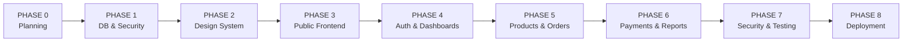

# B-Zooginer — Implementation Plan

This document is the master build plan for B-Zooginer. It breaks the project into phases, defines the deliverables per phase, and provides a task-level breakdown for each. Phases build on each other sequentially; within a phase, tasks may be parallelized where noted.

---

## Table of Contents

1. [Phase Overview](#1-phase-overview)
2. [Phase 0 — Workspace Inspection & Planning](#2-phase-0--workspace-inspection--planning)
3. [Phase 1 — Architecture, Database & Security Design](#3-phase-1--architecture-database--security-design)
4. [Phase 2 — Brand Identity & UI/UX](#4-phase-2--brand-identity--uiux)
5. [Phase 3 — Frontend Foundation & Public Website](#5-phase-3--frontend-foundation--public-website)
6. [Phase 4 — Auth & Role-Based Dashboards](#6-phase-4--auth--role-based-dashboards)
7. [Phase 5 — Product & Order Management](#7-phase-5--product--order-management)
8. [Phase 6 — Payment Management & Reporting](#8-phase-6--payment-management--reporting)
9. [Phase 7 — Security, Testing & Optimization](#9-phase-7--security-testing--optimization)
10. [Phase 8 — Deployment & Documentation](#10-phase-8--deployment--documentation)
11. [Dependencies & Risk Register](#11-dependencies--risk-register)

---

## 1. Phase Overview

| Phase | Name | Key Output |
|-------|------|-----------|
| 0 | Workspace Inspection & Planning | Docs, repo structure, tech decisions |
| 1 | Architecture, Database & Security Design | DB schema, RLS policies, Edge Function skeleton |
| 2 | Brand Identity & UI/UX | Design system, Tailwind config, component library |
| 3 | Frontend Foundation & Public Website | Routing, layouts, public storefront pages |
| 4 | Auth & Role-Based Dashboards | Login, protected routes, dashboard shells |
| 5 | Product & Order Management | Full CRUD for products, variants, and orders |
| 6 | Payment Management & Reporting | Payment status, charts, Excel export |
| 7 | Security, Testing & Optimization | RLS audit, Vitest tests, perf optimization |
| 8 | Deployment & Documentation | Vercel + Supabase prod deploy, final docs |

---

## 2. Phase 0 — Workspace Inspection & Planning

**Goal:** Establish a clean, well-documented starting point. No code is written that isn't infrastructure.

### Deliverables

- [x] `docs/PROJECT_OVERVIEW.md`
- [x] `docs/ARCHITECTURE.md`
- [x] `docs/REQUIREMENTS.md`
- [x] `docs/IMPLEMENTATION_PLAN.md`
- [x] `docs/DATABASE_SCHEMA.md`
- [x] `docs/SECURITY.md`
- [x] `docs/DESIGN_SYSTEM.md`
- [x] `docs/TESTING.md`
- [x] `docs/DEPLOYMENT.md`
- [x] `AGENTS.md`

### Tasks

| # | Task | Notes |
|---|------|-------|
| 0.1 | Initialize Git repository | `git init`, `.gitignore` for Node/Vite/env files |
| 0.2 | Write all planning documents | This document set |
| 0.3 | Define folder structure | As specified in `ARCHITECTURE.md` |
| 0.4 | Create `.env.example` | Document all required env vars |

---

## 3. Phase 1 — Architecture, Database & Security Design

**Goal:** Stand up Supabase project, write all migrations, define all RLS policies, and scaffold Edge Functions.

### Deliverables

- Supabase project created (cloud)
- All DB migration files in `supabase/migrations/`
- RLS policies applied
- `submit-order` Edge Function scaffold
- `supabase/seed.sql` for local dev

### Tasks

| # | Task | Detail |
|---|------|--------|
| 1.1 | Create Supabase project | Via Supabase dashboard; note project URL and anon key |
| 1.2 | Install Supabase CLI | `npm install supabase --save-dev`; `supabase link` |
| 1.3 | Write migration: enums | `role_type`, `po_status_type`, `order_source_type`, `payment_method_type`, `payment_status_type`, `order_status_type` |
| 1.4 | Write migration: `profiles` | Extends `auth.users`; trigger to auto-create on signup |
| 1.5 | Write migration: `groups` | With all columns; unique constraint on `slug` |
| 1.6 | Write migration: `products` | FK to `groups`; index on `group_id`, `is_active` |
| 1.7 | Write migration: `product_variants` | Multi-dimension combinations: title, attributes JSONB, price_adjustment, stock, sort_order |
| 1.8 | Write migration: `orders` | FK to `groups`, `profiles`; unique on `order_code`; high-entropy `access_token` with unique index |
| 1.9 | Write migration: `order_items` | FK to `orders`, `products`, `product_variants`; price & name snapshot + `variant_attributes_snapshot` |
| 1.10 | Write migration: `activity_logs` | Append-only; FK to `profiles` |
| 1.11 | Write migration: `site_settings` | Key-value store; unique on `key` |
| 1.12 | Write all RLS policies | Per policy list in `SECURITY.md` |
| 1.13 | Write DB functions | `generate_order_code()`, `deduct_variant_stock()`, `get_order_confirmation()` |
| 1.14 | Scaffold Edge Function: `submit-order` | Deno; validate payload, call DB functions |
| 1.15 | Write `seed.sql` | 1 group, 2 products, 2 variants, 3 orders |
| 1.16 | Generate TypeScript types | `supabase gen types typescript > src/types/database.types.ts` |
| 1.17 | Test locally | `supabase start`, apply migrations, run seed, verify RLS in Studio |

---

## 4. Phase 2 — Brand Identity & UI/UX

**Goal:** Establish the full design language before building any user-facing pages. All future components reference this system.

### Deliverables

- `tailwind.config.ts` with custom theme (colors, fonts, spacing)
- shadcn/ui initialized and configured
- Core UI primitives customized
- Font imports configured
- Global CSS base styles

### Tasks

| # | Task | Detail |
|---|------|--------|
| 2.1 | Scaffold Vite + React + TypeScript project | `npm create vite@latest . -- --template react-ts` |
| 2.2 | Install and configure Tailwind CSS v3 | `tailwindcss`, `postcss`, `autoprefixer`; `tailwind.config.ts` |
| 2.3 | Configure custom theme | Primary `#1E3A5F`, accent amber `#F59E0B`; custom font scales; spacing |
| 2.4 | Add Google Fonts | Inter, Plus Jakarta Sans, JetBrains Mono via `index.html` or CSS import |
| 2.5 | Initialize shadcn/ui | `npx shadcn-ui@latest init`; configure path aliases |
| 2.6 | Install shadcn/ui components | Button, Input, Label, Select, Dialog, Sheet, Tabs, Badge, Card, Table, Skeleton, Toast, Dropdown Menu, Avatar |
| 2.7 | Customize shadcn theme tokens | Update `globals.css` CSS variables to match brand palette |
| 2.8 | Build `StatusBadge` component | Variants for all `order_status` and `payment_status` values |
| 2.9 | Build `EmptyState` component | Icon + heading + description + optional action button |
| 2.10 | Build `ConfirmDialog` component | Wraps shadcn Dialog; reusable destructive confirmation |
| 2.11 | Build `ImageUploader` component | Drag-and-drop + click; preview; validates type/size |
| 2.12 | Build `DataTable` component | Sortable headers; loading skeleton rows; empty state slot |
| 2.13 | Build `StatCard` component | Icon + label + value + optional trend indicator |
| 2.14 | Verify design system | Visual review of all components in isolation (Storybook or simple dev page) |

---

## 5. Phase 3 — Frontend Foundation & Public Website

**Goal:** Build the React app skeleton with routing and all public-facing pages. No auth required at this stage.

### Deliverables

- Complete routing setup with layouts
- All 5 public pages built and functional (with mock data or Supabase reads)
- Supabase client configured
- Mobile-responsive public layout

### Tasks

| # | Task | Detail |
|---|------|--------|
| 3.1 | Install dependencies | `react-router-dom`, `@tanstack/react-query`, `react-hook-form`, `zod`, `@hookform/resolvers`, `recharts`, `exceljs`, `lucide-react`, `@supabase/supabase-js` |
| 3.2 | Configure path aliases | `@/` → `src/` in `vite.config.ts` and `tsconfig.json` |
| 3.3 | Create `.env.local` | `VITE_SUPABASE_URL`, `VITE_SUPABASE_ANON_KEY` |
| 3.4 | Create `src/lib/supabase.ts` | Singleton Supabase client using env vars |
| 3.5 | Set up React Router | `BrowserRouter`, public layout, admin layout shells, `<Outlet>` |
| 3.6 | Build public `Navbar` | Logo, group links, order lookup link; mobile hamburger drawer |
| 3.7 | Build public `Footer` | Platform name, links; configurable via site_settings |
| 3.8 | Build `HomePage` | Hero banner, group grid (GroupCard × n), announcement banner |
| 3.9 | Build `GroupStorePage` | Group header, product grid (ProductCard × n), PO status awareness |
| 3.10 | Build `ProductDetailPage` | Product image, name, price, variant selector, quantity, "Order Now" CTA |
| 3.11 | Build `OrderFormPage` | Multi-item order form with Zod validation; calls `submit-order` Edge Function |
| 3.12 | Build `OrderConfirmationPage` | `/order/success/:orderCode?token=...`; fetches verified confirmation via RPC `get_order_confirmation` |
| 3.13 | Write Supabase service functions | `groups.service.ts` (published groups), `products.service.ts` (active by group) |
| 3.14 | Write TanStack Query hooks | `useGroups`, `useGroupProducts`, `useOrderConfirmation` |
| 3.15 | Configure `QueryClientProvider` | Wrap app; configure `staleTime`, `retry` defaults |
| 3.16 | Test public flow end-to-end | Browse → select variant combination → submit order → verified confirmation |

---

## 6. Phase 4 — Auth & Role-Based Dashboards

**Goal:** Implement login, session management, route guards, and dashboard shell layouts for both admin roles.

### Deliverables

- `LoginPage` with Supabase email/password auth
- `useAuth` hook with role + group_id resolution
- `RequireAuth` route guard component
- Master Admin dashboard shell (layout + nav + stat cards)
- Group Admin dashboard shell (layout + nav + stat cards)

### Tasks

| # | Task | Detail |
|---|------|--------|
| 4.1 | Build `LoginPage` | Email + password form; Zod validation; Supabase `signInWithPassword` |
| 4.2 | Create `useAuth` hook | Listen to `supabase.auth.onAuthStateChange`; fetch profile; return `{ session, profile, role, groupId, loading }` |
| 4.3 | Create `authStore.ts` (optional) | Zustand store if global auth state needed beyond hook |
| 4.4 | Build `RequireAuth` component | Checks `role`; redirects unauthenticated → `/login`; wrong role → `/login` |
| 4.5 | Register protected routes | Wrap `/master-admin/*` and `/group-admin/*` with `RequireAuth` |
| 4.6 | Build Master Admin `Sidebar` | Navigation links for all MA pages; collapse on mobile |
| 4.7 | Build Master Admin `TopBar` | Breadcrumbs, user menu (name + logout), notification slot |
| 4.8 | Build Master Admin `DashboardPage` | StatCards (total orders, revenue, groups count); order status breakdown |
| 4.9 | Build Group Admin `Sidebar` | Navigation for GA pages; group name in sidebar header |
| 4.10 | Build Group Admin `DashboardPage` | StatCards for own group; recent orders preview table |
| 4.11 | Write `profiles.service.ts` | `getProfile(userId)` |
| 4.12 | Test auth flows | Login as MA → MA dashboard; login as GA → GA dashboard; attempt cross-role route |

---

## 7. Phase 5 — Product & Order Management

**Goal:** Full CRUD for products, variants, and orders. The core operational functionality.

### Deliverables

- Product list, create, edit, deactivate (both roles)
- Variant management within product form
- Order list with filters and search
- Order detail view
- Order status management
- Public order Edge Function wired up

### Tasks

| # | Task | Detail |
|---|------|--------|
| 5.1 | Build MA `GroupsPage` | Table of all groups; publish toggle; link to group detail |
| 5.2 | Build MA `GroupDetailPage` | Edit group form; product list for group; GROUP_ADMIN assignment |
| 5.3 | Build shared `ProductFormPage` | Create/edit product; multi-dimensional variant matrix editor (dimension builder, combination generator, price adjustments, stock inputs) |
| 5.4 | Build MA `ProductsPage` | Products across all groups; filter by group |
| 5.5 | Build GA `ProductsPage` | Own group's products; create/edit/deactivate actions |
| 5.6 | Write `products.service.ts` | CRUD functions for products and variants |
| 5.7 | Write `useProducts` hooks | `useGroupProducts`, `useProduct`, `useCreateProduct`, `useUpdateProduct` |
| 5.8 | Build shared `OrdersPage` | Table with columns: order_code, buyer, class, group, total, payment, status, date |
| 5.9 | Add filters to `OrdersPage` | Filter by order_status, payment_status; date range picker; search input |
| 5.10 | Build shared `OrderDetailPage` | Order header info; items table; status/payment controls |
| 5.11 | Build order status mutation | PATCH `order_status` with optimistic update via TanStack Query |
| 5.12 | Implement `submit-order` Edge Function | Full implementation: validate, generate code, insert order + items, decrement stock |
| 5.13 | Wire `OrderFormPage` to Edge Function | Real submission, error handling, loading state |
| 5.14 | Build MA `UsersPage` | List GROUP_ADMIN accounts; create new GA (Supabase Admin API via Edge Function); deactivate |
| 5.15 | Write `orders.service.ts` | `getOrders`, `getOrderById`, `getOrderByCode`, `updateOrderStatus` |
| 5.16 | Write `useOrders` hooks | Query + mutation hooks |
| 5.17 | Test order lifecycle | Public submit → GA confirms → GA marks paid → GA completes |

---

## 8. Phase 6 — Payment Management & Reporting

**Goal:** Complete payment tracking UI and all reporting/export features.

### Deliverables

- Payment status management page
- Revenue charts (Recharts)
- Excel export (ExcelJS)
- Platform-wide reports (MA) and group-level reports (GA)

### Tasks

| # | Task | Detail |
|---|------|--------|
| 6.1 | Build GA `PaymentsPage` | List of orders with payment_status; "Mark as Paid" action; summary totals |
| 6.2 | Build MA payment overview | Same as GA but across all groups; filterable by group |
| 6.3 | Implement `updatePaymentStatus` service | With RLS check; logs to activity_logs |
| 6.4 | Build `RevenueChart` component | Recharts LineChart or BarChart; revenue by day/week |
| 6.5 | Build MA `ReportsPage` | Platform stats, group comparison bar chart, revenue over time |
| 6.6 | Build GA `ReportsPage` | Group revenue over time, top products chart, payment breakdown |
| 6.7 | Write `reports.service.ts` | Aggregation queries: revenue by date range, revenue by group, top products |
| 6.8 | Implement Excel export | ExcelJS workbook; sheet per data type; styled headers; auto column width |
| 6.9 | Add export button to `OrdersPage` and `ReportsPage` | Triggers ExcelJS download in browser |
| 6.10 | Test reporting accuracy | Verify chart values match raw order data |

---

## 9. Phase 7 — Security, Testing & Optimization

**Goal:** Harden security, write tests for critical flows, and optimize performance.

### Deliverables

- RLS policy audit with test results
- Vitest unit tests for services and validation
- React Testing Library integration tests for key forms
- Performance optimizations applied
- Security checklist reviewed

### Tasks

| # | Task | Detail |
|---|------|--------|
| 7.1 | RLS audit | Manually test every policy using Supabase Studio "as role" mode and anon key; document results |
| 7.2 | Edge Function security review | Verify input validation, rate limiting, no service key leakage |
| 7.3 | Write Zod schema tests | Test all form schemas: valid inputs, boundary cases, invalid inputs |
| 7.4 | Write service unit tests | Mock Supabase client; test `orders.service.ts`, `products.service.ts` |
| 7.5 | Write integration tests | `OrderForm` submission flow; `LoginPage` auth flow |
| 7.6 | Implement code splitting | `React.lazy` + `Suspense` for all admin page routes |
| 7.7 | Optimize images | Ensure all uploads stored as WebP; add `loading="lazy"` to product/group images |
| 7.8 | Tune TanStack Query `staleTime` | Products: 120s; Orders: 15s; Groups: 300s |
| 7.9 | Add loading skeletons | Skeleton loaders on all data tables and card grids |
| 7.10 | Accessibility pass | Tab order, aria-labels on icon buttons, focus trap in modals |
| 7.11 | Error boundary | Global `ErrorBoundary` component wrapping admin routes |
| 7.12 | 404 and fallback pages | Custom 404 page; redirect unknown routes to `/` |

---

## 10. Phase 8 — Deployment & Documentation

**Goal:** Deploy to production on Vercel + Supabase Cloud. Finalize all documentation.

### Deliverables

- Production Supabase project with migrations applied
- Production Vercel deployment
- Storage buckets configured
- Edge Functions deployed
- Final `DEPLOYMENT.md` checklist completed

### Tasks

| # | Task | Detail |
|---|------|--------|
| 8.1 | Apply migrations to production Supabase | `supabase db push` against production project |
| 8.2 | Configure Storage buckets | Create `groups-media`, `products-media`, `site-assets`; set public access policies |
| 8.3 | Deploy Edge Functions | `supabase functions deploy submit-order` |
| 8.4 | Create MASTER_ADMIN account | Via Supabase Auth dashboard + manual `profiles` insert |
| 8.5 | Create Vercel project | Connect GitHub repo; set environment variables |
| 8.6 | Deploy to Vercel | Trigger production build; verify build succeeds |
| 8.7 | Configure custom domain (if applicable) | Via Vercel domain settings |
| 8.8 | Smoke test production | End-to-end: browse → order → lookup; login MA → all features; login GA → group features |
| 8.9 | Finalize documentation | Update `DEPLOYMENT.md` with actual URLs, bucket names, function names |
| 8.10 | Seed initial data | Create groups, products via Master Admin dashboard |
| 8.11 | Handoff | Provide MASTER_ADMIN credentials; share platform URL; deliver docs |

---

## 11. Dependencies & Risk Register

### Inter-Phase Dependencies

| Phase | Depends On | Blocking Deliverable |
|-------|-----------|---------------------|
| Phase 2 | Phase 1 | TypeScript types from Supabase schema |
| Phase 3 | Phase 1, 2 | Supabase client + design system |
| Phase 4 | Phase 3 | Routing foundation |
| Phase 5 | Phase 4 | Auth + dashboard shells |
| Phase 6 | Phase 5 | Order data to report on |
| Phase 7 | Phase 5, 6 | All features to test and secure |
| Phase 8 | Phase 7 | Stable, tested codebase |

### Risk Register

| Risk | Likelihood | Impact | Mitigation |
|------|-----------|--------|-----------|
| Supabase RLS policy gap | Medium | High | Test every policy in local dev before production; run RLS audit in Phase 7 |
| Order code collision | Low | Medium | Use DB unique constraint + retry logic in Edge Function |
| Concurrent stock deduction | Low | High | Atomic decrement via PostgreSQL function; check stock > 0 in same transaction |
| Service role key leakage | Low | Critical | Edge Function only; never in frontend env vars; audit with git-secret or similar |
| Excel export memory on large datasets | Low | Low | Paginate data in export service; stream if needed |
| Vercel build failure | Low | Medium | Test build locally with `vite build` before pushing |
| Supabase cold start latency | Low | Low | Edge Functions are on Supabase's low-latency infra; acceptable for school scale |
