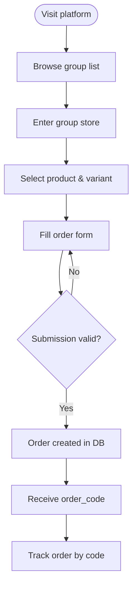
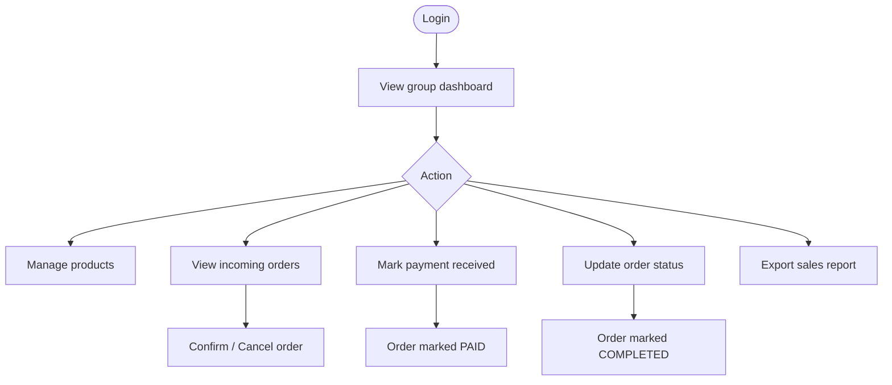
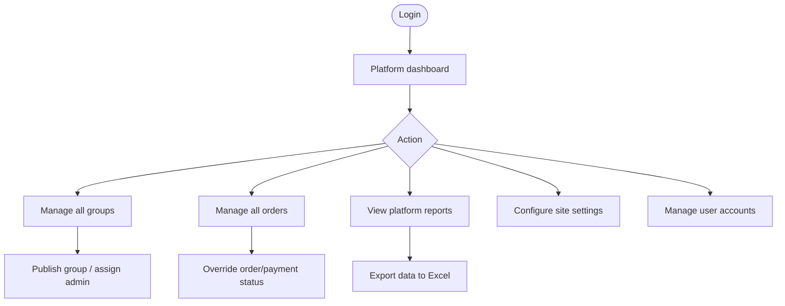

# B-Zooginer — Project Overview

> **B-Zooginer** is a school-based pre-order management platform that enables student entrepreneurship groups to run structured product pre-orders, manage payments, and track orders — all from a single, unified platform.

---

## Table of Contents

1. [Purpose & Problem Statement](#1-purpose--problem-statement)
2. [Target Users](#2-target-users)
3. [Core Features](#3-core-features)
4. [User Journeys](#4-user-journeys)
5. [Tech Stack Summary](#5-tech-stack-summary)
6. [Project Scope & Constraints](#6-project-scope--constraints)
7. [Success Criteria](#7-success-criteria)
8. [Glossary](#8-glossary)

---

## 1. Purpose & Problem Statement

School entrepreneurship programs often run pre-orders manually — via paper forms, WhatsApp broadcast, or spreadsheets — leading to:

- **Lost orders** due to informal channels
- **No payment tracking** — cash collected with no digital record
- **No cross-group visibility** for administrators
- **Inconsistent pricing and variant management**

**B-Zooginer** solves this by providing:

- A **public storefront** where buyers can browse group stores and submit orders without an account
- **Group Admin dashboards** where student group leaders manage their own products and orders
- A **Master Admin dashboard** with full platform oversight, reporting, and configuration

---

## 2. Target Users

| Role | Count | Access | Description |
|------|-------|--------|-------------|
| `MASTER_ADMIN` | 1 | Full platform | School admin/teacher with unrestricted access to all data, settings, and groups |
| `GROUP_ADMIN` | 1 per group (5–10 total) | Own group only | Student group leader; manages their group's products, orders, and payments |
| `PUBLIC` | Unlimited, anonymous | Storefront only | Buyers (students, parents, teachers); browse products and submit orders without an account |

> [!IMPORTANT]
> `PUBLIC` users have anonymous access and never create an account. Order confirmation is securely accessed via the human-readable `order_code` combined with a high-entropy `access_token` to protect buyer privacy against order enumeration.

---

## 3. Core Features

### 3.1 Public Storefront

| Feature | Description |
|---------|-------------|
| Group listing | Browse all published student groups with poster, name, and PO status |
| Group store page | View products for a specific group |
| Product detail | View product info, multi-dimensional variants (size, flavor), dynamic price |
| Order form | Submit an order anonymously (name, class, WhatsApp, items, payment method) |
| Order confirmation | View verified order confirmation via `order_code` + `access_token` |

### 3.2 Group Admin Dashboard

| Feature | Description |
|---------|-------------|
| Product management | Create, edit, deactivate products and variants |
| Order management | View, confirm, cancel, complete orders for own group |
| Payment management | Mark orders as paid; view payment summary |
| Reporting | Sales summary, revenue charts, export to Excel |
| Group profile | Update group name, poster, description, PO status |

### 3.3 Master Admin Dashboard

| Feature | Description |
|---------|-------------|
| All-groups overview | View orders and stats across all groups |
| Group management | Create/edit/publish groups; assign Group Admin accounts |
| Product management | View and manage any group's products |
| Order management | Full CRUD on all orders |
| Payment management | Full payment status control |
| Reporting | Platform-wide revenue, order counts, group comparisons |
| Site settings | Manage platform name, logo, announcements |
| User management | Create/deactivate Group Admin accounts |

---

## 4. User Journeys

### 4.1 Public Buyer

### 4.2 Group Admin

### 4.3 Master Admin

---

## 5. Tech Stack Summary

| Layer | Technology |
|-------|-----------|
| **Frontend framework** | React 18 + TypeScript |
| **Build tool** | Vite |
| **Styling** | Tailwind CSS v3 |
| **UI components** | shadcn/ui (Radix UI primitives) |
| **Icons** | Lucide React |
| **Routing** | React Router v6 |
| **Server state** | TanStack Query v5 |
| **Forms** | React Hook Form + Zod |
| **Charts** | Recharts |
| **Excel export** | ExcelJS |
| **Backend** | Supabase (PostgreSQL + Auth + Storage + Edge Functions) |
| **Database** | PostgreSQL via Supabase, with RLS |
| **Hosting** | Vercel (frontend) + Supabase Cloud (backend) |

> [!NOTE]
> No separate custom backend server is needed. All backend logic runs through Supabase Edge Functions, RLS policies, and PostgreSQL functions.

---

## 6. Project Scope & Constraints

### In Scope

- Multi-group pre-order management
- Role-based access control (MASTER_ADMIN, GROUP_ADMIN, PUBLIC anonymous)
- Product and multi-dimensional variant management per group (e.g. Size AND Flavor)
- Order creation from all three sources
- High-entropy access token protection for public order confirmations
- Payment status tracking (CASH / TRANSFER) with Group Admin and Master Admin confirmation
- Order status lifecycle (NEW → CONFIRMED → COMPLETED / CANCELLED)
- Dashboard analytics and reporting with Excel export
- Responsive design (mobile-first, desktop-optimized admin)
- 100% Bahasa Indonesia user interface

### Out of Scope (v1)

- Online payment gateway integration (no Midtrans/Stripe/etc.)
- Real-time push notifications
- Email/SMS notifications
- Multiple school instances / multi-tenancy
- Mobile native app (iOS/Android)
- Inventory purchase order management
- Customer loyalty / points system

### Constraints

| Constraint | Detail |
|-----------|--------|
| Single master admin | Only 1 `MASTER_ADMIN` account; created manually |
| No self-registration | Group Admins are created by Master Admin only |
| Anonymous public ordering | Public orders require no login |
| Token-gated confirmation | Public confirmation requires `order_code` + `access_token` to prevent enumeration |
| UI Language | 100% Bahasa Indonesia across all public and administrative interfaces |
| Payment is offline | Platform tracks payment status only; no payment processing |
| Group isolation | Group Admins see only their own group's data |

---

## 7. Success Criteria

| Criterion | Measure |
|-----------|---------|
| Public ordering works without account | A buyer can submit an order and view confirmation with `order_code` + `access_token` |
| Group Admin isolation is enforced | A Group Admin cannot access another group's data via UI or API |
| Master Admin has full visibility | All orders across all groups visible in one dashboard |
| Payment status is trackable | Every order has `payment_status` (UNPAID/PAID) editable by authorized admins |
| Data export works | Sales reports exportable to `.xlsx` via ExcelJS |
| RLS enforced at DB level | Direct Supabase API calls by unauthorized roles are blocked |
| Mobile-responsive | Public storefront fully usable on 375px viewport |
| Performance | LCP < 2.5s on public storefront (Vercel CDN + Supabase edge) |

---

## 8. Glossary

| Term | Definition |
|------|-----------|
| **Group** | A student entrepreneurship unit selling one or more products (Stan Kelompok Siswa) |
| **PO** | Pre-order period; defined by `po_open_at` / `po_close_at` on products (Pemesanan Awal) |
| **order_code** | Unique human-readable identifier for an order (e.g. `BZG-20261121-A3X9`) |
| **access_token** | 256-bit cryptographically secure token protecting public order confirmation against enumeration |
| **order_status** | Lifecycle state: `NEW → CONFIRMED → COMPLETED` or `CANCELLED` (Baru, Dikonfirmasi, Selesai, Dibatalkan) |
| **payment_status** | Whether an order has been paid: `UNPAID` or `PAID` (Belum Bayar, Lunas) |
| **payment_method** | How payment is made: `CASH` or `TRANSFER` (Tunai, Transfer Bank / QRIS) |
| **source** | Who created the order: `master_admin`, `group_admin`, or `public` |
| **RLS** | Row-Level Security — PostgreSQL mechanism enforced by Supabase |
| **Edge Function** | Supabase serverless function (Deno) for secure server-side logic |
| **variant** | A product option combination across dimensions (e.g. Ukuran + Rasa) with price adjustment and stock |
| **snapshot** | A copy of the unit price at time of order, frozen against future price changes |
