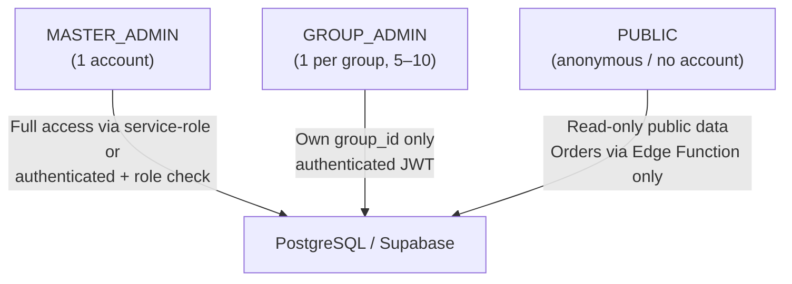

# SECURITY.md — B-Zooginer

> [!IMPORTANT]
> This document defines the complete security model for B-Zooginer. Every developer and AI agent working on this project must read this before touching auth, RLS policies, Edge Functions, or anything related to data access.

---

## Table of Contents

1. [Role Model](#role-model)
2. [RLS Overview](#rls-overview)
3. [RLS Policies — Table by Table](#rls-policies--table-by-table)
   - [profiles](#profiles-rls)
   - [groups](#groups-rls)
   - [products](#products-rls)
   - [product_variants](#product_variants-rls)
   - [orders](#orders-rls)
   - [order_items](#order_items-rls)
   - [activity_logs](#activity_logs-rls)
   - [site_settings](#site_settings-rls)
4. [Edge Function: Public Order Submission](#edge-function-public-order-submission)
5. [RPC Functions (SECURITY DEFINER)](#rpc-functions-security-definer)
6. [Role Security Analysis](#role-security-analysis)
7. [Intentionally Prohibited Actions](#intentionally-prohibited-actions)
8. [Security Checklist](#security-checklist)

---

## Role Model

B-Zooginer has three user types with strictly separated capabilities:



| Role | Auth State | Supabase Role | Group Scope |
|---|---|---|---|
| `MASTER_ADMIN` | Authenticated | `authenticated` | All groups |
| `GROUP_ADMIN` | Authenticated | `authenticated` | Own `group_id` only |
| `PUBLIC` | Anonymous | `anon` | None (read-only public data) |

### Role Determination

The role is stored in `profiles.role`. To read it inside an RLS policy:

```sql
-- Helper function used in RLS policies
CREATE OR REPLACE FUNCTION public.get_my_role()
RETURNS public.user_role
LANGUAGE sql STABLE SECURITY DEFINER SET search_path = public AS $$
  SELECT role FROM public.profiles WHERE id = auth.uid()
$$;

CREATE OR REPLACE FUNCTION public.get_my_group_id()
RETURNS uuid
LANGUAGE sql STABLE SECURITY DEFINER SET search_path = public AS $$
  SELECT group_id FROM public.profiles WHERE id = auth.uid()
$$;

CREATE OR REPLACE FUNCTION public.is_master_admin()
RETURNS boolean
LANGUAGE sql STABLE SECURITY DEFINER SET search_path = public AS $$
  SELECT EXISTS (
    SELECT 1 FROM public.profiles
    WHERE id = auth.uid() AND role = 'master_admin'
  )
$$;
```

> [!NOTE]
> `SECURITY DEFINER` on these helper functions means they run as the function owner (superuser), bypassing RLS when reading `profiles`. This is intentional — without it, reading `profiles` to determine role would create a circular RLS dependency.

---

## RLS Overview

All tables have Row Level Security **enabled and enforced**. The anon key is public (embedded in the frontend); security comes entirely from RLS policies, not from keeping the key secret.

```sql
-- Enable RLS on all tables
ALTER TABLE public.profiles        ENABLE ROW LEVEL SECURITY;
ALTER TABLE public.groups          ENABLE ROW LEVEL SECURITY;
ALTER TABLE public.products        ENABLE ROW LEVEL SECURITY;
ALTER TABLE public.product_variants ENABLE ROW LEVEL SECURITY;
ALTER TABLE public.orders          ENABLE ROW LEVEL SECURITY;
ALTER TABLE public.order_items     ENABLE ROW LEVEL SECURITY;
ALTER TABLE public.activity_logs   ENABLE ROW LEVEL SECURITY;
ALTER TABLE public.site_settings   ENABLE ROW LEVEL SECURITY;
```

> [!CAUTION]
> **FORCE RLS** is set for all tables including table owners. Never disable RLS for debugging on production. Use the Supabase SQL editor with service-role credentials or a local dev environment instead.

```sql
ALTER TABLE public.profiles        FORCE ROW LEVEL SECURITY;
ALTER TABLE public.groups          FORCE ROW LEVEL SECURITY;
ALTER TABLE public.products        FORCE ROW LEVEL SECURITY;
ALTER TABLE public.product_variants FORCE ROW LEVEL SECURITY;
ALTER TABLE public.orders          FORCE ROW LEVEL SECURITY;
ALTER TABLE public.order_items     FORCE ROW LEVEL SECURITY;
ALTER TABLE public.activity_logs   FORCE ROW LEVEL SECURITY;
ALTER TABLE public.site_settings   FORCE ROW LEVEL SECURITY;
```

### Policy Naming Convention

```
<table>_<operation>_<who>
```

Examples: `orders_select_master_admin`, `products_insert_group_admin`, `groups_select_public`.

---

## RLS Policies — Table by Table

---

### profiles RLS

**Rules:**
- Users can read and update **only their own** profile.
- Only `master_admin` can update `role` or `group_id` on any profile.
- No direct INSERT or DELETE via client (managed by trigger and service role).

```sql
-- Users can read their own profile
CREATE POLICY profiles_select_own
  ON public.profiles FOR SELECT
  USING (id = auth.uid());

-- master_admin can read all profiles
CREATE POLICY profiles_select_master_admin
  ON public.profiles FOR SELECT
  USING (public.is_master_admin());

-- Users can update their own profile (but NOT role or group_id)
CREATE POLICY profiles_update_own
  ON public.profiles FOR UPDATE
  USING (id = auth.uid())
  WITH CHECK (
    id = auth.uid()
    AND role = (SELECT role FROM public.profiles WHERE id = auth.uid())
    AND group_id IS NOT DISTINCT FROM (SELECT group_id FROM public.profiles WHERE id = auth.uid())
  );

-- master_admin can update any profile (including role and group_id)
CREATE POLICY profiles_update_master_admin
  ON public.profiles FOR UPDATE
  USING (public.is_master_admin());
```

**Pseudocode:**

| Operation | Who | Allowed | Condition |
|---|---|---|---|
| SELECT | Own user | ✅ | `id = auth.uid()` |
| SELECT | MASTER_ADMIN | ✅ | `is_master_admin()` |
| SELECT | GROUP_ADMIN (others) | ❌ | — |
| SELECT | PUBLIC (anon) | ❌ | — |
| UPDATE | Own user | ✅ (restricted fields) | Cannot change `role` or `group_id` |
| UPDATE | MASTER_ADMIN | ✅ | Any field, any profile |
| INSERT | Any client | ❌ | Managed by `handle_new_user` trigger only |
| DELETE | Any client | ❌ | Managed by Supabase Auth cascade only |

---

### groups RLS

**Rules:**
- PUBLIC can SELECT groups where `is_published = true`.
- GROUP_ADMIN can SELECT and UPDATE **only their own group**.
- MASTER_ADMIN has full CRUD.

```sql
-- Public: read published groups only
CREATE POLICY groups_select_public
  ON public.groups FOR SELECT
  USING (is_published = true);

-- Group admin: read own group
CREATE POLICY groups_select_group_admin
  ON public.groups FOR SELECT
  USING (
    auth.uid() IS NOT NULL
    AND id = public.get_my_group_id()
  );

-- Master admin: read all groups
CREATE POLICY groups_select_master_admin
  ON public.groups FOR SELECT
  USING (public.is_master_admin());

-- Group admin: update own group only (cannot change id or created_by)
CREATE POLICY groups_update_group_admin
  ON public.groups FOR UPDATE
  USING (id = public.get_my_group_id())
  WITH CHECK (id = public.get_my_group_id());

-- Master admin: full write access
CREATE POLICY groups_insert_master_admin
  ON public.groups FOR INSERT
  WITH CHECK (public.is_master_admin());

CREATE POLICY groups_update_master_admin
  ON public.groups FOR UPDATE
  USING (public.is_master_admin());

CREATE POLICY groups_delete_master_admin
  ON public.groups FOR DELETE
  USING (public.is_master_admin());
```

| Operation | Who | Allowed | Condition |
|---|---|---|---|
| SELECT | PUBLIC | ✅ (partial) | `is_published = true` only |
| SELECT | GROUP_ADMIN | ✅ (own group) | `id = get_my_group_id()` |
| SELECT | MASTER_ADMIN | ✅ (all) | — |
| INSERT | PUBLIC | ❌ | — |
| INSERT | GROUP_ADMIN | ❌ | Groups created by MASTER_ADMIN |
| INSERT | MASTER_ADMIN | ✅ | — |
| UPDATE | GROUP_ADMIN | ✅ (own group) | Cannot change `id`, `slug`, `created_by` |
| UPDATE | MASTER_ADMIN | ✅ (all) | — |
| DELETE | Any non-admin | ❌ | — |
| DELETE | MASTER_ADMIN | ✅ | — |

---

### products RLS

**Rules:**
- PUBLIC can SELECT `is_active = true` products of **published** groups.
- GROUP_ADMIN can full CRUD on own group's products.
- MASTER_ADMIN has full CRUD on all.

```sql
-- Public: active products of published groups
CREATE POLICY products_select_public
  ON public.products FOR SELECT
  USING (
    is_active = true
    AND EXISTS (
      SELECT 1 FROM public.groups g
      WHERE g.id = group_id AND g.is_published = true
    )
  );

-- Group admin: all products in own group
CREATE POLICY products_select_group_admin
  ON public.products FOR SELECT
  USING (group_id = public.get_my_group_id() AND auth.uid() IS NOT NULL);

-- Master admin: all products
CREATE POLICY products_select_master_admin
  ON public.products FOR SELECT
  USING (public.is_master_admin());

-- Group admin: insert products for own group only
CREATE POLICY products_insert_group_admin
  ON public.products FOR INSERT
  WITH CHECK (
    group_id = public.get_my_group_id()
    AND auth.uid() IS NOT NULL
  );

-- Group admin: update own group's products
CREATE POLICY products_update_group_admin
  ON public.products FOR UPDATE
  USING (group_id = public.get_my_group_id())
  WITH CHECK (group_id = public.get_my_group_id());

-- Group admin: delete own group's products
CREATE POLICY products_delete_group_admin
  ON public.products FOR DELETE
  USING (group_id = public.get_my_group_id());

-- Master admin: full write
CREATE POLICY products_insert_master_admin
  ON public.products FOR INSERT
  WITH CHECK (public.is_master_admin());

CREATE POLICY products_update_master_admin
  ON public.products FOR UPDATE
  USING (public.is_master_admin());

CREATE POLICY products_delete_master_admin
  ON public.products FOR DELETE
  USING (public.is_master_admin());
```

| Operation | Who | Allowed | Condition |
|---|---|---|---|
| SELECT | PUBLIC | ✅ (filtered) | `is_active = true` AND parent group published |
| SELECT | GROUP_ADMIN | ✅ (own group) | — |
| SELECT | MASTER_ADMIN | ✅ (all) | — |
| INSERT | PUBLIC | ❌ | — |
| INSERT | GROUP_ADMIN | ✅ (own group) | Cannot set `group_id` to another group |
| INSERT | MASTER_ADMIN | ✅ | — |
| UPDATE | GROUP_ADMIN | ✅ (own group) | — |
| UPDATE | MASTER_ADMIN | ✅ | — |
| DELETE | GROUP_ADMIN | ✅ (own group) | — |
| DELETE | MASTER_ADMIN | ✅ | — |

---

### product_variants RLS

Variants inherit visibility from their parent product. The same `group_id` scoping applies via a JOIN to `products`.

```sql
-- Public: active variants of active products of published groups
CREATE POLICY variants_select_public
  ON public.product_variants FOR SELECT
  USING (
    is_active = true
    AND EXISTS (
      SELECT 1 FROM public.products p
      JOIN public.groups g ON g.id = p.group_id
      WHERE p.id = product_id
        AND p.is_active = true
        AND g.is_published = true
    )
  );

-- Group admin: variants of own group's products
CREATE POLICY variants_select_group_admin
  ON public.product_variants FOR SELECT
  USING (
    auth.uid() IS NOT NULL
    AND EXISTS (
      SELECT 1 FROM public.products p
      WHERE p.id = product_id AND p.group_id = public.get_my_group_id()
    )
  );

-- Master admin: all variants
CREATE POLICY variants_select_master_admin
  ON public.product_variants FOR SELECT
  USING (public.is_master_admin());

-- Group admin: write variants for own group's products
CREATE POLICY variants_insert_group_admin
  ON public.product_variants FOR INSERT
  WITH CHECK (
    EXISTS (
      SELECT 1 FROM public.products p
      WHERE p.id = product_id AND p.group_id = public.get_my_group_id()
    )
  );

CREATE POLICY variants_update_group_admin
  ON public.product_variants FOR UPDATE
  USING (
    EXISTS (
      SELECT 1 FROM public.products p
      WHERE p.id = product_id AND p.group_id = public.get_my_group_id()
    )
  );

CREATE POLICY variants_delete_group_admin
  ON public.product_variants FOR DELETE
  USING (
    EXISTS (
      SELECT 1 FROM public.products p
      WHERE p.id = product_id AND p.group_id = public.get_my_group_id()
    )
  );

-- Master admin: full write
CREATE POLICY variants_all_master_admin
  ON public.product_variants FOR ALL
  USING (public.is_master_admin())
  WITH CHECK (public.is_master_admin());
```

---

### orders RLS

> [!CAUTION]
> **Public users CANNOT directly INSERT into `orders`.** All public order submissions go through the `submit-order` Edge Function using the **service role key**, which bypasses RLS. The anon role has NO insert policy on `orders`.

```sql
-- Group admin: select own group's orders only
CREATE POLICY orders_select_group_admin
  ON public.orders FOR SELECT
  USING (
    auth.uid() IS NOT NULL
    AND group_id = public.get_my_group_id()
  );

-- Master admin: select all orders
CREATE POLICY orders_select_master_admin
  ON public.orders FOR SELECT
  USING (public.is_master_admin());

-- Group admin: insert orders for own group (admin-placed orders)
CREATE POLICY orders_insert_group_admin
  ON public.orders FOR INSERT
  WITH CHECK (
    group_id = public.get_my_group_id()
    AND auth.uid() IS NOT NULL
  );

-- Master admin: insert orders for any group
CREATE POLICY orders_insert_master_admin
  ON public.orders FOR INSERT
  WITH CHECK (public.is_master_admin());

-- Group admin: update status and confirm payments for own group's orders
CREATE POLICY orders_update_group_admin
  ON public.orders FOR UPDATE
  USING (
    group_id = public.get_my_group_id()
    AND auth.uid() IS NOT NULL
  )
  WITH CHECK (
    group_id = public.get_my_group_id()
  );

-- Master admin: update anything
CREATE POLICY orders_update_master_admin
  ON public.orders FOR UPDATE
  USING (public.is_master_admin());

-- Master admin: delete orders (soft-delete preferred via cancelled status)
CREATE POLICY orders_delete_master_admin
  ON public.orders FOR DELETE
  USING (public.is_master_admin());

-- PUBLIC: NO direct SELECT, NO INSERT, NO UPDATE, NO DELETE
-- (Order submission goes through submit-order Edge Function; confirmation lookup is via get_order_confirmation RPC with high-entropy access_token)
```

| Operation | Who | Allowed | Condition |
|---|---|---|---|
| SELECT | PUBLIC | ❌ | Use RPC `get_order_confirmation` with `order_code` + `access_token` |
| SELECT | GROUP_ADMIN | ✅ (own group) | Cannot see other groups' orders |
| SELECT | MASTER_ADMIN | ✅ (all) | — |
| INSERT | PUBLIC (direct) | ❌ | Use Edge Function only |
| INSERT | GROUP_ADMIN | ✅ (own group) | Manual orders for assigned group |
| INSERT | MASTER_ADMIN | ✅ | Manual orders for any group |
| UPDATE `payment_status` | GROUP_ADMIN | ✅ (own group) | Confirm payments for assigned group |
| UPDATE `payment_status` | MASTER_ADMIN | ✅ | Confirm/override payments for any group |
| UPDATE `order_status` | GROUP_ADMIN | ✅ (own group) | Manage lifecycle for assigned group |
| UPDATE (any) | MASTER_ADMIN | ✅ | Full management |
| DELETE | PUBLIC / GROUP_ADMIN | ❌ | Orders cannot be deleted; cancel instead |
| DELETE | MASTER_ADMIN | ✅ (restricted) | Emergency maintenance only; cancel preferred |

---

### order_items RLS

Order items inherit access from their parent order. Policy uses a subquery join to `orders`.

```sql
-- Group admin: view items of own group's orders
CREATE POLICY order_items_select_group_admin
  ON public.order_items FOR SELECT
  USING (
    auth.uid() IS NOT NULL
    AND EXISTS (
      SELECT 1 FROM public.orders o
      WHERE o.id = order_id AND o.group_id = public.get_my_group_id()
    )
  );

-- Master admin: view all order items
CREATE POLICY order_items_select_master_admin
  ON public.order_items FOR SELECT
  USING (public.is_master_admin());

-- Group admin: insert items into own group's orders
CREATE POLICY order_items_insert_group_admin
  ON public.order_items FOR INSERT
  WITH CHECK (
    EXISTS (
      SELECT 1 FROM public.orders o
      WHERE o.id = order_id AND o.group_id = public.get_my_group_id()
    )
  );

-- Master admin: insert any items
CREATE POLICY order_items_insert_master_admin
  ON public.order_items FOR INSERT
  WITH CHECK (public.is_master_admin());

-- No UPDATE on order_items (snapshots are immutable)
-- No DELETE except cascade from orders (handled by DB, not RLS)

-- PUBLIC: no access at all
```

> [!NOTE]
> `order_items` are **immutable after creation** by design. No UPDATE policy exists. If a correction is needed, the order must be cancelled and re-placed. This preserves audit integrity.

---

### activity_logs RLS

Append-only. No UPDATE or DELETE. Only authenticated users can INSERT; only MASTER_ADMIN can SELECT.

```sql
-- Only master_admin can read logs
CREATE POLICY activity_logs_select_master_admin
  ON public.activity_logs FOR SELECT
  USING (public.is_master_admin());

-- Authenticated users can insert logs (both master_admin and group_admin)
CREATE POLICY activity_logs_insert_authenticated
  ON public.activity_logs FOR INSERT
  WITH CHECK (auth.uid() IS NOT NULL);

-- NO UPDATE policy
-- NO DELETE policy
-- PUBLIC (anon): no access
```

| Operation | Who | Allowed | Notes |
|---|---|---|---|
| SELECT | MASTER_ADMIN | ✅ | Full audit trail |
| SELECT | GROUP_ADMIN | ❌ | Cannot read logs |
| SELECT | PUBLIC | ❌ | — |
| INSERT | Authenticated (any role) | ✅ | Logs written client-side or by Edge Function |
| UPDATE | Anyone | ❌ | Logs are immutable |
| DELETE | Anyone | ❌ | Logs are immutable |

---

### site_settings RLS

Singleton row. Everyone can read; only MASTER_ADMIN can update.

```sql
-- Everyone (including anon) can read site settings
CREATE POLICY site_settings_select_all
  ON public.site_settings FOR SELECT
  USING (true);

-- Only master_admin can update
CREATE POLICY site_settings_update_master_admin
  ON public.site_settings FOR UPDATE
  USING (public.is_master_admin())
  WITH CHECK (public.is_master_admin());

-- No INSERT or DELETE (singleton enforced by DB constraint)
```

| Operation | Who | Allowed | Notes |
|---|---|---|---|
| SELECT | Anyone | ✅ | Public storefront reads hero content |
| UPDATE | MASTER_ADMIN | ✅ | — |
| UPDATE | GROUP_ADMIN / PUBLIC | ❌ | — |
| INSERT | Anyone | ❌ | Singleton row seeded at migration |
| DELETE | Anyone | ❌ | — |

---

## Edge Function: Public Order Submission

Public users cannot call `INSERT` on the `orders` table. Instead, they submit via an Edge Function that:

1. Validates all inputs server-side.
2. Verifies the group's `po_status = 'open'` and `is_published = true`.
3. Verifies each product is `is_active = true` and within PO window.
4. Calls `generate_order_code()` to get a unique code.
5. Calls `deduct_variant_stock()` for each item with stock tracking.
6. Inserts the `orders` row using the **service role client** (bypasses RLS).
7. Inserts `order_items` rows.
8. Returns the `order_code` to the buyer.

### File Location

```
supabase/functions/submit-order/index.ts
```

### Implementation Outline

```typescript
// supabase/functions/submit-order/index.ts
import { serve } from 'https://deno.land/std/http/server.ts';
import { createClient } from 'https://esm.sh/@supabase/supabase-js@2';

const corsHeaders = {
  'Access-Control-Allow-Origin': '*',
  'Access-Control-Allow-Headers': 'authorization, x-client-info, apikey, content-type',
};

interface OrderItem {
  product_id: string;
  variant_id?: string | null;
  quantity: number;
}

interface SubmitOrderPayload {
  group_id: string;
  buyer_name: string;
  buyer_class: string;
  whatsapp?: string;
  payment_method: 'cash' | 'transfer';
  notes?: string;
  items: OrderItem[];
}

serve(async (req: Request) => {
  if (req.method === 'OPTIONS') {
    return new Response('ok', { headers: corsHeaders });
  }

  // Service role client — bypasses RLS
  const supabase = createClient(
    Deno.env.get('SUPABASE_URL')!,
    Deno.env.get('SUPABASE_SERVICE_ROLE_KEY')!,
  );

  try {
    const payload: SubmitOrderPayload = await req.json();

    // 1. Input validation
    if (!payload.group_id || !payload.buyer_name || !payload.buyer_class) {
      return new Response(
        JSON.stringify({ error: 'Missing required fields' }),
        { status: 400, headers: { ...corsHeaders, 'Content-Type': 'application/json' } },
      );
    }
    if (!payload.items?.length) {
      return new Response(
        JSON.stringify({ error: 'Order must contain at least one item' }),
        { status: 400, headers: { ...corsHeaders, 'Content-Type': 'application/json' } },
      );
    }

    // 2. Verify group is open for orders
    const { data: group, error: groupErr } = await supabase
      .from('groups')
      .select('id, po_status, is_published')
      .eq('id', payload.group_id)
      .single();

    if (groupErr || !group) {
      return new Response(
        JSON.stringify({ error: 'Group not found' }),
        { status: 404, headers: { ...corsHeaders, 'Content-Type': 'application/json' } },
      );
    }
    if (!group.is_published || group.po_status !== 'open') {
      return new Response(
        JSON.stringify({ error: 'Pre-order is not currently open for this group' }),
        { status: 422, headers: { ...corsHeaders, 'Content-Type': 'application/json' } },
      );
    }

    // 3. Validate & price each item
    const resolvedItems = [];
    let total = 0;
    const now = new Date();

    for (const item of payload.items) {
      const { data: product } = await supabase
        .from('products')
        .select('id, name, base_price, has_variants, track_stock, is_active, po_open_at, po_close_at, max_po_qty')
        .eq('id', item.product_id)
        .eq('group_id', payload.group_id)
        .single();

      if (!product || !product.is_active) {
        throw new Error(`Product ${item.product_id} is not available`);
      }

      // Check PO window
      if (product.po_open_at && new Date(product.po_open_at) > now) {
        throw new Error(`Product ${product.name} is not yet open for pre-order`);
      }
      if (product.po_close_at && new Date(product.po_close_at) < now) {
        throw new Error(`Product ${product.name} pre-order has closed`);
      }

      // Check max quantity
      if (product.max_po_qty && item.quantity > product.max_po_qty) {
        throw new Error(`Quantity exceeds limit for ${product.name}`);
      }

      let unitPrice = Number(product.base_price);
      let variantSnapshot: string | null = null;

      if (product.has_variants && item.variant_id) {
        const { data: variant } = await supabase
          .from('product_variants')
          .select('id, label, value, price_adjustment, is_active')
          .eq('id', item.variant_id)
          .eq('product_id', item.product_id)
          .single();

        if (!variant || !variant.is_active) {
          throw new Error(`Variant ${item.variant_id} not available`);
        }

        unitPrice += Number(variant.price_adjustment);
        variantSnapshot = `${variant.label}: ${variant.value}`;
      }

      const subtotal = unitPrice * item.quantity;
      total += subtotal;

      resolvedItems.push({
        product_id: product.id,
        variant_id: item.variant_id ?? null,
        product_name_snapshot: product.name,
        variant_snapshot: variantSnapshot,
        unit_price_snapshot: unitPrice,
        quantity: item.quantity,
        subtotal,
      });
    }

    // 4. Generate order code
    const { data: orderCode, error: codeErr } = await supabase.rpc('generate_order_code');
    if (codeErr || !orderCode) {
      throw new Error('Failed to generate order code');
    }

    // 5. Insert order
    const { data: order, error: orderErr } = await supabase
      .from('orders')
      .insert({
        order_code: orderCode,
        group_id: payload.group_id,
        buyer_name: payload.buyer_name,
        buyer_class: payload.buyer_class,
        whatsapp: payload.whatsapp ?? null,
        source: 'public',
        payment_method: payload.payment_method,
        total,
        notes: payload.notes ?? null,
        created_by: null,
      })
      .select('id, order_code, access_token')
      .single();

    if (orderErr || !order) {
      throw new Error(`Failed to insert order: ${orderErr?.message}`);
    }

    // 6. Deduct stock & insert order items
    for (const resolved of resolvedItems) {
      if (resolved.variant_id) {
        await supabase.rpc('deduct_variant_stock', {
          p_variant_id: resolved.variant_id,
          p_quantity: resolved.quantity,
        });
      }

      await supabase.from('order_items').insert({
        order_id: order.id,
        ...resolved,
      });
    }

    // 7. Return order code and secure access token to buyer
    return new Response(
      JSON.stringify({
        order_code: order.order_code,
        access_token: order.access_token,
      }),
      { status: 201, headers: { ...corsHeaders, 'Content-Type': 'application/json' } },
    );

  } catch (err: unknown) {
    const message = err instanceof Error ? err.message : 'Internal error';
    return new Response(
      JSON.stringify({ error: message }),
      { status: 500, headers: { ...corsHeaders, 'Content-Type': 'application/json' } },
    );
  }
});
```

> [!WARNING]
> **Never expose `SUPABASE_SERVICE_ROLE_KEY` to the browser or frontend code.** It is only accessible inside Edge Functions via `Deno.env.get(...)`. The frontend uses only `VITE_SUPABASE_ANON_KEY`.

---

## RPC Functions (SECURITY DEFINER)

These are Postgres functions callable by clients but executed with elevated permissions. They are the safe gateway for specific privileged operations.

### `get_order_confirmation(p_order_code text, p_access_token text)`

Allows the public buyer to look up **their own order confirmation** by combining their human-readable `order_code` with the high-entropy 256-bit `access_token` generated upon submission.

> [!SECURITY]
> **Anti-Enumeration Protection:** If orders were accessible by `order_code` alone (`BZG-YYYYMMDD-XXXX`), an attacker or curious student could easily brute-force or scrape all student pre-orders across classes (only 4 alphanumeric chars = ~1M combinations). By requiring the 64-character random hex `access_token` (`encode(gen_random_bytes(32), 'hex')`), unauthorized order enumeration is cryptographically impossible ($2^{256}$ keyspace).

```sql
CREATE OR REPLACE FUNCTION public.get_order_confirmation(
  p_order_code   text,
  p_access_token text
)
RETURNS TABLE (
  order_code      text,
  buyer_name      text,
  buyer_class     text,
  group_name      text,
  order_status    public.order_status,
  payment_status  public.payment_status,
  payment_method  public.payment_method,
  total           numeric,
  order_date      date,
  items           jsonb
)
LANGUAGE plpgsql SECURITY DEFINER SET search_path = public AS $$
BEGIN
  RETURN QUERY
  SELECT
    o.order_code,
    o.buyer_name,
    o.buyer_class,
    g.name AS group_name,
    o.order_status,
    o.payment_status,
    o.payment_method,
    o.total,
    o.order_date,
    COALESCE(
      jsonb_agg(
        jsonb_build_object(
          'product_name', oi.product_name_snapshot,
          'variant',      oi.variant_snapshot,
          'unit_price',   oi.unit_price_snapshot,
          'quantity',     oi.quantity,
          'subtotal',     oi.subtotal
        )
      ) FILTER (WHERE oi.id IS NOT NULL),
      '[]'::jsonb
    ) AS items
  FROM public.orders o
  JOIN public.groups g ON g.id = o.group_id
  LEFT JOIN public.order_items oi ON oi.order_id = o.id
  WHERE o.order_code = p_order_code
    AND o.access_token = p_access_token
  GROUP BY o.order_code, o.buyer_name, o.buyer_class, g.name,
           o.order_status, o.payment_status, o.payment_method,
           o.total, o.order_date;
END;
$$;
```

**What this exposes:** Only the specific buyer's verified order summary — verified by both `order_code` and `access_token`.

**What it does NOT expose:** Full `orders` table, other buyers' records, internal database UUIDs, or administrative notes.

---

### `submit_public_order(...)` (Alternative: DB-level atomic RPC)

An alternative to the Edge Function approach — a single SECURITY DEFINER RPC that wraps the entire order submission in a Postgres transaction. Preferred when Edge Function cold-start latency is a concern.

```sql
-- Defined in migration; called by Edge Function or directly by anon client
-- Uses SECURITY DEFINER to bypass RLS for order insertion only
-- Full implementation deferred to Edge Function approach for better input validation
```

---

## Role Security Analysis

### MASTER_ADMIN

| Capability | Method | Notes |
|---|---|---|
| Full CRUD on all tables | Authenticated + RLS `is_master_admin()` | — |
| Change any user's role | Direct UPDATE on `profiles` | Only via authenticated session |
| Mark orders as paid | UPDATE `orders.payment_status` | GROUP_ADMIN cannot do this |
| View all activity logs | SELECT `activity_logs` | — |
| Update site settings | UPDATE `site_settings` | — |
| Create groups | INSERT `groups` | — |

**Threat model:** If a MASTER_ADMIN account is compromised, an attacker has full data access. Mitigations:
- Enforce strong password + MFA in Supabase Auth.
- Restrict MASTER_ADMIN login IP if possible via Supabase Auth hooks.
- Activity logs capture all admin changes.

### GROUP_ADMIN

| Capability | Method | Notes |
|---|---|---|
| Manage own group's products | Full CRUD via `group_id` scope | Cannot touch other groups |
| View own group's orders | SELECT via `group_id` scope | — |
| Place orders on behalf of buyers | INSERT `orders` with `source = 'group_admin'` | — |
| Update order status | UPDATE `order_status` only | Cannot change `payment_status` |
| Cannot change own role | Blocked by `WITH CHECK` on `profiles` | — |
| Cannot reassign own group | Blocked by `WITH CHECK` on `profiles` | — |

**What GROUP_ADMIN cannot do (intentionally):**
- Read orders of another group.
- Change `payment_status` (this is a money concern — MASTER_ADMIN only).
- Create or delete groups.
- Read the activity log.
- Modify site settings.

### PUBLIC (Anonymous)

| Capability | Method | Notes |
|---|---|---|
| Read published groups | SELECT `groups WHERE is_published = true` | — |
| Read active products | SELECT `products WHERE is_active = true AND group.is_published = true` | — |
| Read site settings | SELECT `site_settings` | — |
| Submit order | POST to Edge Function | Edge Function validates + inserts via service role |
| Look up own order | RPC `get_order_by_code` | Returns limited fields only |

**What PUBLIC cannot do (intentionally):**
- INSERT directly into `orders` table.
- SELECT the `orders` table (no SELECT RLS policy for anon).
- Read any `profiles` data.
- Access `activity_logs`.
- Change `payment_status` or `order_status`.

---

## Intentionally Prohibited Actions

The following are explicitly disallowed by design. This section documents the **why** for each.

| Prohibited Action | Who Is Blocked | Why |
|---|---|---|
| Anonymous INSERT into `orders` | PUBLIC | Bypasses validation, rate limits, stock checks. Use Edge Function. |
| Anonymous SELECT on `orders` | PUBLIC | Full order table exposes buyer PII. Use `get_order_confirmation` RPC with access_token. |
| GROUP_ADMIN updating `payment_status` for other groups | GROUP_ADMIN | Group isolation. Group admins can only confirm payments for their own assigned group. |
| GROUP_ADMIN reading other groups' orders | GROUP_ADMIN | PII isolation between groups. Each group only manages their own sales. |
| GROUP_ADMIN changing own `role` or `group_id` | GROUP_ADMIN | Prevents privilege escalation. Role assignment is MASTER_ADMIN only. |
| Any client UPDATEing `order_items` | All | Snapshots are immutable. Altering them corrupts financial records. |
| Any client DELETEing `activity_logs` | All | Audit logs must be tamper-proof. |
| Any client INSERTing into `site_settings` | All | Singleton row; enforced by DB constraint + no INSERT RLS policy. |
| Storing `SUPABASE_SERVICE_ROLE_KEY` in frontend | Developers | Service role bypasses all RLS. Frontend only uses anon key. |
| Using `service_role` client in browser code | Developers | Same as above. Only safe inside Edge Functions and server-side code. |
| Disabling RLS for performance | Developers | Use indexes and partial indexes instead. |

---

## Security Checklist

Use this before each deployment.

### Database

- [ ] RLS enabled + forced on all 8 tables
- [ ] All helper functions (`is_master_admin`, `get_my_role`, `get_my_group_id`) use `SECURITY DEFINER`
- [ ] `handle_new_user` trigger runs as `SECURITY DEFINER`
- [ ] `generate_order_code()` function deployed
- [ ] `deduct_variant_stock()` function deployed
- [ ] `get_order_confirmation(p_order_code, p_access_token)` RPC deployed with anti-enumeration protection
- [ ] `idx_orders_access_token` unique index deployed
- [ ] No table has a permissive `USING (true)` policy for INSERT/UPDATE/DELETE
- [ ] `order_items` has no UPDATE policy (immutable after insert)
- [ ] `activity_logs` has no UPDATE or DELETE policy

### Edge Function

- [ ] `submit-order` uses `SUPABASE_SERVICE_ROLE_KEY` (env var, not hardcoded)
- [ ] All payload fields are validated before DB operations
- [ ] Group `po_status` and `is_published` verified before accepting order
- [ ] Product `is_active` and PO window verified per item
- [ ] Stock deduction happens before order item insert; rollback on failure
- [ ] CORS headers restricted to your domain in production (not `*`)
- [ ] Rate limiting configured in Supabase Edge Function settings

### Frontend / Client

- [ ] Only `VITE_SUPABASE_ANON_KEY` is in `.env` — never `SERVICE_ROLE_KEY`
- [ ] No `.env` values committed to Git (`.env` in `.gitignore`)
- [ ] No direct DB calls for order submission — always through Edge Function
- [ ] Auth state validated before showing admin UI
- [ ] Redirects enforce role-based routing (master_admin vs group_admin routes)

### Auth

- [ ] MFA enabled for MASTER_ADMIN account in Supabase Auth settings
- [ ] Email confirmation enabled for new users
- [ ] Supabase Auth email templates customized (avoid phishing confusion)
- [ ] Session expiry configured (Supabase default: 1 hour access token, 7 days refresh)

### Storage

- [ ] `groups-media` bucket: authenticated upload, public read for published groups
- [ ] `products-media` bucket: authenticated upload, public read for active products
- [ ] `site-assets` bucket: authenticated upload, public read
- [ ] File size limit: 2 MB max (enforced in bucket policy)
- [ ] Allowed MIME types: `image/jpeg`, `image/png`, `image/webp` only
- [ ] Storage paths scoped by `group_id` to prevent cross-group overwrites:
  ```
  groups-media/{group_id}/logo.webp
  groups-media/{group_id}/poster.webp
  products-media/{group_id}/{product_id}/image.webp
  ```

---

*Last updated: 2026-11-21 | Maintained by: MASTER_ADMIN / db-writer agent*
